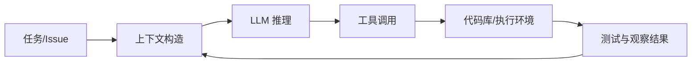
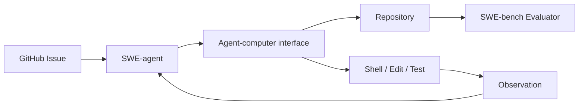
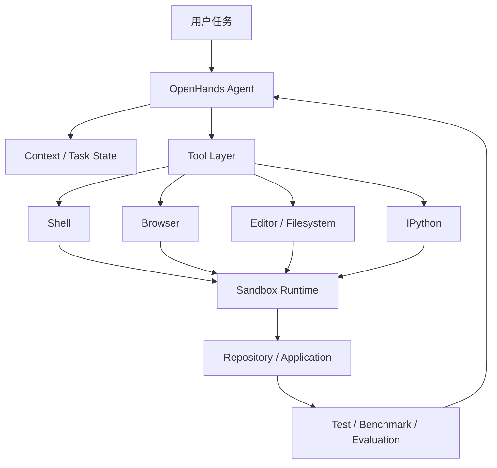
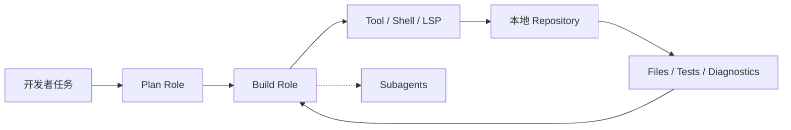
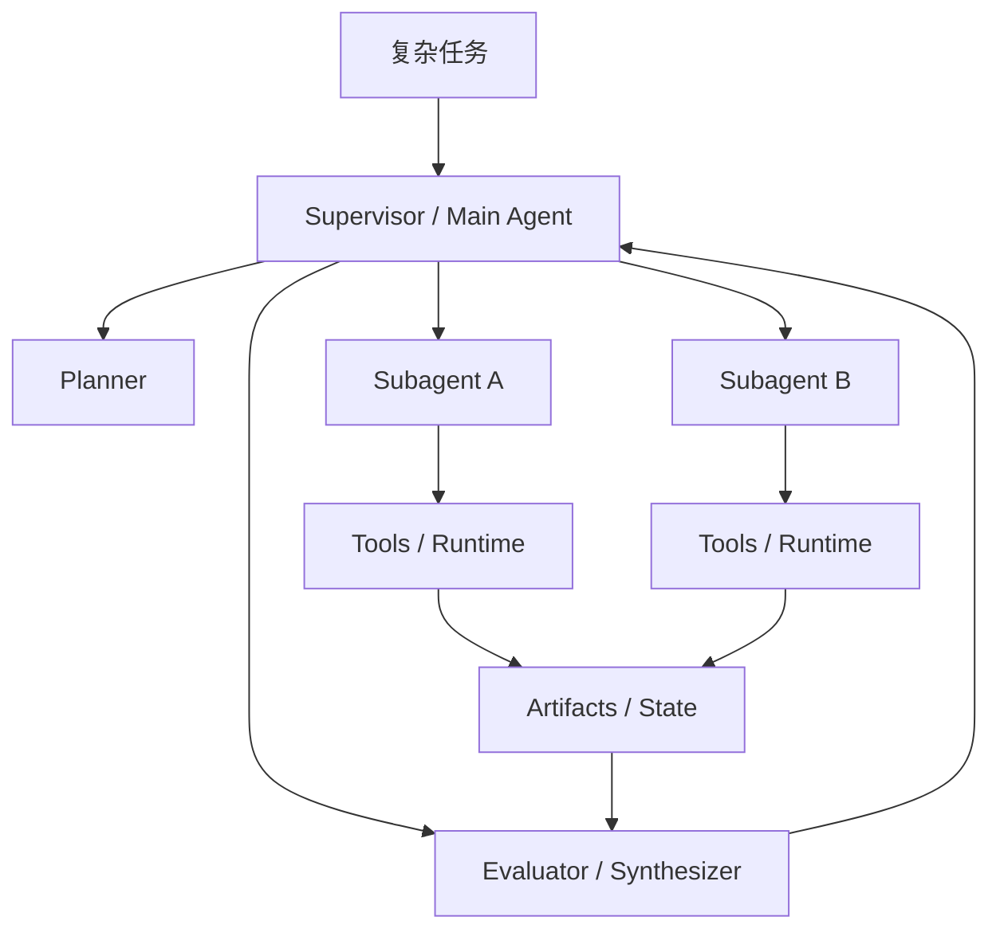
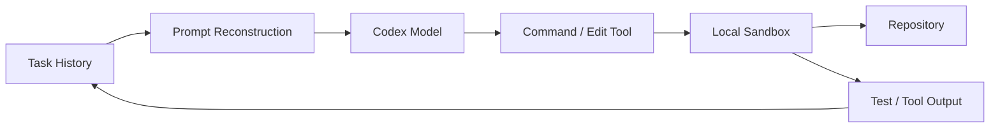
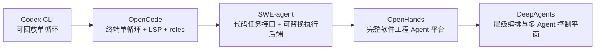
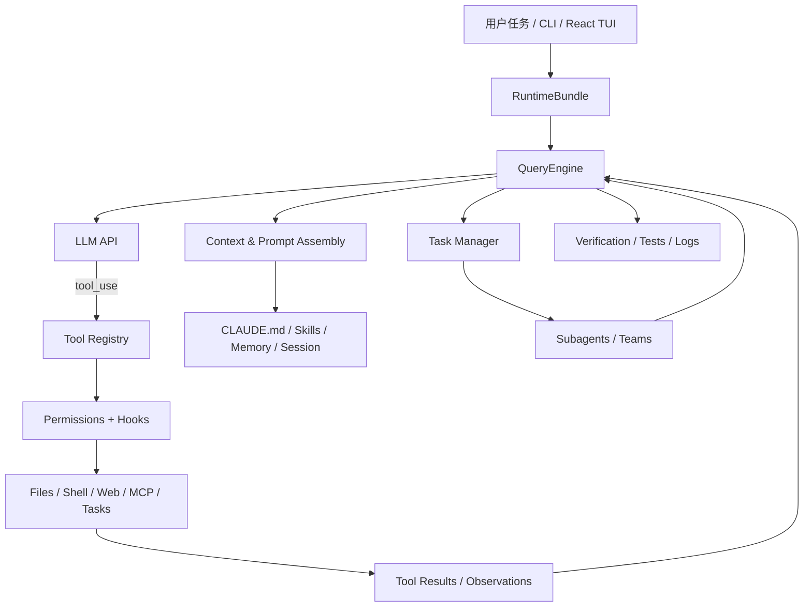
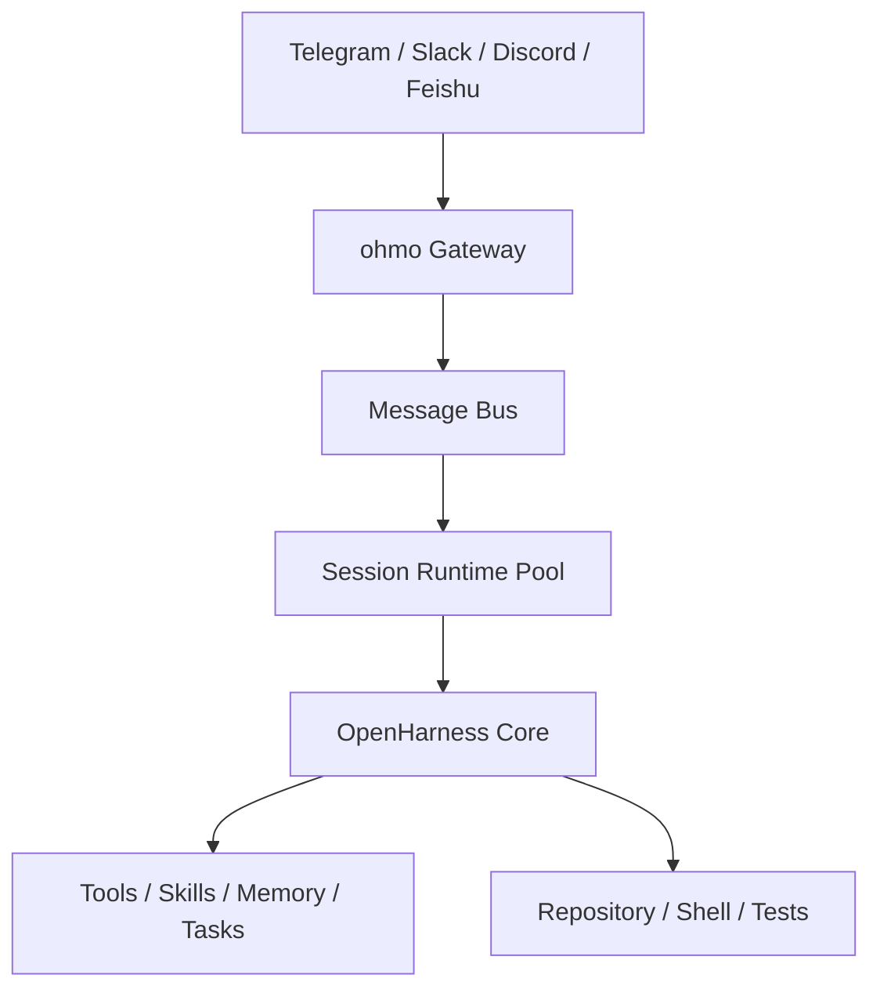
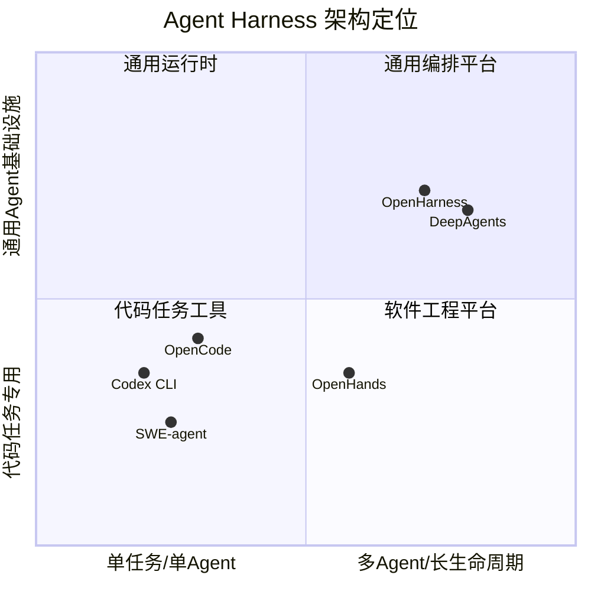

Updated todo list

I'll先从综述中的架构分类和这五个项目的具体条目入手，核对它们的执行环境、工具接口、上下文、编排、验证与治理边界，再给出横向对比。

Searched for regex `SWE-agent|OpenHands|OpenCode|DeepAgents|Codex CLI` (`**/MinerU_markdown_26_Agent_Harness_Engineering-_A_Survey_2097471925570002944.md`), 23 results

综述已经给出一个关键分层：SWE-agent/OpenHands 更偏完整软件工程运行时，OpenCode/Codex CLI 更偏终端单 Agent loop，而 DeepAgents 更偏可复用的层级编排框架。下面我会用这一分层补齐各项目的架构职责和差异。

Read , lines 488 to 535

对比框架已经明确：五者都共享“模型调用循环 + 工具执行 + 代码库状态 + 验证反馈”，真正的分界在于它们把多少能力放进 Harness，以及是否支持多 Agent、持久状态和可替换执行后端。我再核对项目条目后给出矩阵和选型结论。

Read , lines 2515 to 2525

## 总体结论

这五个项目都可以抽象成同一个基本闭环：



差别主要不在“有没有 Agent loop”，而在于 Harness 的边界：

- **SWE-agent**：围绕 SWE-bench 和 issue 修复构建的研究型 Harness。
- **OpenHands**：面向完整软件工程任务的开放平台和 SDK。
- **OpenCode**：面向终端开发者体验的开源 coding agent。
- **DeepAgents**：面向复杂任务分解和多 Agent 编排的框架。
- **Codex CLI**：强调可回放、可验证的终端单 Agent loop。

综述将 OpenCode、Codex CLI、SWE-agent 归入单 Agent inner loop；DeepAgents 归入层级式多 Agent orchestration；OpenHands 则被描述为结合 sandbox、工具交互、任务状态和评测的平台型系统。详见 `MinerU_markdown_26_Agent_Harness_Engineering-_A_Survey_2097471925570002944.md:488`。

## 架构对比表

| 维度 | SWE-agent | OpenHands | OpenCode | DeepAgents | Codex CLI |
|---|---|---|---|---|---|
| 核心定位 | SWE-bench / issue 修复 Agent | 软件工程 Agent 平台与 SDK | 终端 coding agent | 深层任务与多 Agent 编排框架 | 终端代码 Agent |
| 主要控制流 | 单 Agent loop | Agent loop + 软件工程运行时 | 单 Agent loop，带 plan/build 角色 | 层级式 supervisor/subagent | 单 Agent loop |
| 任务分解 | 较弱，主要由单 Agent 完成 | 中等，可扩展 | 中等，依靠 plan/build/subagent | 强，原生强调拆解和委派 | 较弱，偏线性执行 |
| 执行环境 | 通过 SWE-ReX 接入 Docker、Fargate、Modal、Daytona 等 | 集成 sandbox、shell、浏览器、IPython 等 | 本地终端/客户端服务器运行时 | 依赖可配置的工具和执行器 | 本地终端 sandbox |
| 工具抽象 | Agent-computer interface | Shell、浏览器、文件系统、代码工具 | Shell、LSP、编辑工具、subagent | Tool / middleware / subagent 抽象 | Shell、文件编辑、测试命令 |
| 代码库交互 | 仓库导航、编辑、测试 | 完整 repo-level 开发 | 本地仓库编辑和 LSP 辅助 | 通过工具和子 Agent 操作仓库 | 本地仓库编辑和命令执行 |
| 状态模型 | 运行轨迹 + 仓库状态 | 任务状态 + 持久化产物 + 会话 | Hybrid，结合会话和本地文件 | Stateful，保存子任务和协调状态 | 偏 stateless replay |
| 多 Agent | 非核心 | 可扩展，但不是最核心抽象 | 有 subagent，但仍以单 Agent 为主 | 核心能力 | 非核心 |
| 验证方式 | 测试、SWE-bench evaluator | benchmark、测试、任务结果 | 测试和命令反馈 | 可组合 evaluator / feedback loop | 测试和执行反馈 |
| 可观测性 | 以轨迹和评测为主 | 平台级任务和运行状态 | 终端/会话级 | 可插入 tracing 和 middleware | 强调 loop replay |
| 治理与权限 | 主要依赖执行后端和 sandbox | sandbox + 用户确认/权限边界 | 本地运行时权限 | 由框架和应用自行配置 | sandbox 和命令执行边界 |
| 最适合 | 研究代码修复、SWE-bench | 构建软件工程 Agent 产品 | 日常终端编程 | 复杂长流程、多 Agent 系统 | 可控的终端代码任务 |

综述附录对其中四个项目的定位也基本一致：OpenCode 是带 plan/build、subagent、LSP 和 client-server runtime 的终端 Agent；Codex CLI 是偏无状态回放的终端 Agent；OpenHands 是开放的软件工程 Agent 平台；SWE-agent 则围绕 agent-computer interface 和 SWE-ReX 执行后端展开，见 `MinerU_markdown_26_Agent_Harness_Engineering-_A_Survey_2097471925570002944.md:2525`。

## 1. SWE-agent

### 核心架构



SWE-agent 的核心不是一个通用多 Agent 框架，而是一个针对软件工程任务设计的 **Agent-computer interface**。

它把以下动作统一成 Agent 可操作、可记录、可评测的接口：

- 浏览和搜索仓库
- 打开和修改文件
- 执行 shell 命令
- 运行测试
- 接收命令输出
- 根据结果继续修复

其重要设计思想是：**工具接口本身就是研究变量**。Agent 的性能不只取决于 LLM，也取决于它如何看到仓库、如何编辑文件、如何获得测试反馈。

### 优点

- 对代码修复任务边界清晰。
- 轨迹容易记录和复现。
- SWE-bench 集成紧密。
- SWE-ReX 使执行后端可替换。

### 局限

- 原生任务分解和多 Agent 协作能力较弱。
- 更像“高质量的软件工程实验 Harness”，不是完整的通用开发平台。
- 平台级 observability、治理和产品化能力相对有限。

综述将 SWE-ReX 描述为统一 Docker、AWS Fargate、Modal、Daytona 等后端的运行时接口，这也是 SWE-agent 与其他终端 Agent 的一个明显区别，见 `MinerU_markdown_26_Agent_Harness_Engineering-_A_Survey_2097471925570002944.md:293`。

## 2. OpenHands

### 核心架构



OpenHands 的定位更接近一个 **软件工程 Agent 平台**，而不是单纯的 Agent loop。

它的架构把多个部分放在同一个系统中：

- Agent 控制循环
- Shell 和文件操作
- 浏览器操作
- IPython 等执行工具
- Docker sandbox
- 任务状态
- SDK 扩展接口
- 软件工程任务评测

### 优点

- 对 repo-level 软件开发覆盖较完整。
- 能处理不仅是代码修改，还包括浏览器、命令行和应用运行。
- 有较强的平台化和 SDK 化倾向。
- 执行环境和 Agent 能力集成较紧密。

### 局限

- 组件较多，系统复杂度高。
- Sandbox、工具、Agent、评测之间耦合比 SWE-agent 更强。
- 如果只想构建一个简单 coding loop，可能显得偏重。

OpenHands 在综述中被归类为同时覆盖 Execution、Tooling、Context、Lifecycle 和 Verification 的平台型实现，而不是只覆盖单一的 L 层或 E 层，见 `MinerU_markdown_26_Agent_Harness_Engineering-_A_Survey_2097471925570002944.md:2525`。

## 3. OpenCode

### 核心架构



OpenCode 是一个更贴近开发者工作台的 **终端 coding agent**。

相比 SWE-agent，它更强调：

- 交互式终端体验
- plan/build 角色分离
- LSP 集成
- subagent
- client-server runtime
- 本地开发环境整合

它的基本结构依然是单 Agent loop，但通过角色和 subagent 增加了少量结构化能力。

### 优点

- 适合交互式本地开发。
- LSP 能提供代码诊断、跳转和语言级反馈。
- plan/build 分离比纯粹的单循环更清晰。
- subagent 机制为局部探索或辅助任务提供扩展点。

### 局限

- 多 Agent 编排不是主要抽象。
- 任务状态和长流程管理不如 DeepAgents 系统化。
- 更偏终端产品和开发工具，不是专门为基准测试设计的研究 Harness。

综述对 OpenCode 的描述是“开源终端代码 Agent，具备 plan/build roles、subagents、LSP support 和 client-server runtime”，见 `MinerU_markdown_26_Agent_Harness_Engineering-_A_Survey_2097471925570002944.md:2525`。

## 4. DeepAgents

### 核心架构



DeepAgents 与前面几个项目的最大区别是：它不是主要围绕“终端里如何编辑代码”组织，而是围绕 **复杂任务如何拆解、委派、执行、汇总和验证** 组织。

其核心抽象通常包括：

- 主 Agent 或 supervisor
- planning
- subagent delegation
- 工具路由
- 共享状态或任务结果
- evaluator / feedback
- 长流程控制

综述把 DeepAgents 归入 **Hierarchical orchestration**，而把 OpenCode、Codex CLI、SWE-agent 归入 Single-Agent Inner Loop，见 `MinerU_markdown_26_Agent_Harness_Engineering-_A_Survey_2097471925570002944.md:522`。

### 优点

- 任务分解能力强。
- 适合并行探索、角色分工和多阶段验证。
- 更容易表达长流程和复杂依赖。
- 比单 Agent loop 更适合构造研究型 Harness。

### 局限

- 协调开销更高。
- 子 Agent 之间的上下文、状态和错误传播更复杂。
- 对简单代码编辑任务可能过度设计。
- 最终代码质量仍取决于工具、执行环境和验证器，不会自动因“多 Agent”而提升。

DeepAgents 更像是五者中的 **控制平面**，而 SWE-agent、OpenHands 和 Codex CLI 更像是包含执行面的完整代码 Agent。

## 5. Codex CLI

### 核心架构



Codex CLI 的核心是一个 **终端原生、偏 stateless replay 的单 Agent loop**。

它强调：

- 结构化 prompt
- 工具调用记录
- 本地命令执行
- 文件修改
- 测试和验证反馈
- 交互历史回放

它的“可回放”特征很重要：Harness 可以根据历史交互重建一次运行，而不是完全依赖隐藏在外部服务中的状态。

### 优点

- 运行模型简单、边界清晰。
- 便于回放和调试。
- 工具调用、命令输出和测试反馈都属于显式 loop。
- 适合本地终端代码修改。

### 局限

- 原生任务分解能力有限。
- 多 Agent 协作不是核心。
- 对复杂 issue-to-PR 生命周期的支持需要外围系统补充。
- 更接近一个高质量 coding runtime，而不是完整的软件工程平台。

综述明确将 Codex CLI 视为 stateless replay-oriented 的典型，而将实用型 coding agent 通常归为“历史回放 + 持久化文件/仓库”的 hybrid 模型，见 `MinerU_markdown_26_Agent_Harness_Engineering-_A_Survey_2097471925570002944.md:510`。

## 主要相同点

### 1. 都是模型外包裹的 Harness

五个项目都不把 LLM API 当作完整系统，而是在模型外面加入：

- prompt/context 构造
- 工具调用协议
- 文件和仓库操作
- shell 或代码执行
- 状态保存
- 错误恢复
- 测试反馈

这对应 ETCLOVG 中的 Execution、Tooling、Context 和 Lifecycle 四个核心层。

### 2. 都以代码库为主要状态载体

它们都依赖以下持久化对象：

- repository
- working tree
- files
- patches
- test results
- command output
- task history

因此代码 Agent 的“记忆”并不完全存在于上下文窗口中，很多关键状态通过文件系统和 Git 工作树保存。

### 3. 都采用反馈闭环

典型路径都是：

```text
读取代码
→ 规划修改
→ 调用工具
→ 执行代码或测试
→ 读取错误
→ 修改代码
→ 再次验证
```

这意味着代码生成不是一次性文本生成，而是一个带执行反馈的控制循环。

### 4. 都需要隔离执行环境

SWE-agent、OpenHands 和 Codex CLI 尤其明显，都需要限制 Agent 执行命令时对主机、文件系统和网络的影响。OpenCode 和 DeepAgents 也需要通过运行时或工具层接入类似的权限控制。

综述将 sandbox 同时视为安全、可复现性和长任务 liveness 的基础设施，见 `MinerU_markdown_26_Agent_Harness_Engineering-_A_Survey_2097471925570002944.md:241`。

## 主要不同点

### 1. 单 Agent Loop vs. 层级编排

这是最重要的结构差异：

```text
单 Agent loop：
SWE-agent / OpenCode / Codex CLI

平台型 Agent：
OpenHands

层级式 orchestration：
DeepAgents
```

单 Agent loop 的优点是简单、可控、易回放；缺点是复杂任务容易出现上下文膨胀、规划失败和长程错误积累。

层级式编排可以把规划、探索、实现和验证拆开，但需要处理：

- 子任务依赖
- 共享上下文
- 状态同步
- 结果合并
- 多 Agent 成本
- 错误归因

### 2. 执行环境的归属不同

| 项目 | 执行环境的架构位置 |
|---|---|
| SWE-agent | 通过 SWE-ReX 抽象成可替换后端 |
| OpenHands | 作为平台内置的重要组成部分 |
| OpenCode | 偏本地终端和 client-server runtime |
| DeepAgents | 主要通过工具/执行器组合接入 |
| Codex CLI | 偏本地终端 sandbox 和命令执行 |

SWE-agent 更强调“Agent 与执行后端解耦”；OpenHands 更强调“把完整软件工程环境打包进平台”；Codex CLI 和 OpenCode 更接近本地开发运行时。

### 3. 状态策略不同

```text
Codex CLI：
历史回放优先

SWE-agent：
交互轨迹 + 仓库状态

OpenCode：
会话状态 + 本地工作树

OpenHands：
任务状态 + 会话 + 工件 + 运行环境

DeepAgents：
协调状态 + 子任务状态 + 共享结果
```

状态越丰富，长任务恢复能力越强，但一致性和调试难度也越高。综述明确区分了 stateless replay、stateful execution 和 hybrid execution，见 `MinerU_markdown_26_Agent_Harness_Engineering-_A_Survey_2097471925570002944.md:502`。

### 4. 验证目标不同

- **SWE-agent**：重点是 SWE-bench 任务是否修复。
- **OpenHands**：关注软件工程任务是否完成，以及平台是否能支持多种开发操作。
- **OpenCode**：更多依赖开发者实时查看、测试和诊断。
- **DeepAgents**：验证器是可组合的，可以作为层级流程的一部分。
- **Codex CLI**：强调测试、命令结果和 loop replay。

因此，SWE-agent 的 evaluator 更像实验基准的一部分，而 DeepAgents 的 evaluator 更像编排流程中的一个组件。

## 架构上的继承关系

可以把五者放在下面这条演化线上：



这不是严格的项目依赖关系，而是架构能力范围的扩展关系：

1. **Codex CLI** 解决“一个 Agent 如何可靠操作本地代码”。
2. **OpenCode** 增强交互式开发、LSP、角色和 subagent。
3. **SWE-agent** 把代码操作接口和执行环境变成可研究、可评测的 Harness。
4. **OpenHands** 把代码 Agent 扩展为完整的软件工程运行平台。
5. **DeepAgents** 进一步解决复杂任务的分解、委派和多 Agent 协调。

## 选型建议

| 目标 | 首选 |
|---|---|
| 研究 SWE-bench 或代码修复 | SWE-agent |
| 构建完整的软件工程 Agent | OpenHands |
| 做本地终端 coding agent | OpenCode |
| 研究多 Agent、任务分解和长流程 | DeepAgents |
| 研究单 Agent loop、回放和工具反馈 | Codex CLI |
| 需要可替换 sandbox 后端 | SWE-agent / OpenHands |
| 需要较强的浏览器、shell、应用运行能力 | OpenHands |
| 需要简单、低延迟、容易调试的架构 | Codex CLI / OpenCode |

**一句话概括：**

- **SWE-agent 是评测导向的代码修复 Harness。**
- **OpenHands 是平台导向的软件工程 Harness。**
- **OpenCode 是开发者体验导向的终端 Harness。**
- **DeepAgents 是编排导向的多 Agent Harness。**
- **Codex CLI 是回放和验证导向的单 Agent Harness。**

Updated todo list

I'll先确认你指的 OpenHarness 具体项目及其公开架构信息，再把它放回前面五个项目的同一组维度中比较，避免把不同的 “OpenHarness” 项目混在一起。

Searched for regex `OpenHarness|Open Harness|open-harness|openharness`, 1 result


Read , lines 2513 to 2516

工作区只确认了一个名为 OpenHarness 的条目，标签是“生命周期编排、工具使用、记忆、多 Agent”，但没有记录仓库归属；我现在查它的公开仓库信息和 README，再据此做准确比较。

Ran terminal command: $result = Invoke-RestMethod -Uri 'https://api.github.com/search/repositories?q=OpenHarness+agent' -Headers @{ 'User-Agent' = 'VSCode-Copilot' }; $result.items | Select-Object -First 10 full_name,description,html_url,stargazers_count,updated_at | Format-List

Searched hkuds/openharness for "README architecture components agent loop tools memory multi-agent Ohmo CLI SDK repository structure", 64 results

可以。这里的 OpenHarness 指的是 **HKUDS/OpenHarness**，不是前面几个项目的“模型”，而是一个开源 Agent Harness 框架。它的定位比 OpenCode、Codex CLI 更完整，也比单纯的代码 Agent 更强调工具、记忆、插件和多 Agent 协作。

## OpenHarness 的整体架构

OpenHarness 的核心可以概括为：



项目 README 将它拆成约 10 个核心子系统：

```text
openharness/
  engine/          Agent Loop
  tools/           文件、Shell、搜索、Web、MCP 工具
  skills/          按需加载的 Markdown 知识
  plugins/         commands、hooks、agents、MCP 扩展
  permissions/     权限模式、路径规则、命令限制
  hooks/           PreToolUse / PostToolUse 生命周期钩子
  commands/        斜杠命令和交互命令
  mcp/             MCP 客户端
  memory/          跨会话持久记忆
  tasks/           后台任务管理
  coordinator/     Subagent 和团队协调
```

其核心 Agent loop 大致是：

```python
while True:
    response = await api.stream(messages, tools)

    if response.stop_reason != "tool_use":
        break

    for tool_call in response.tool_uses:
        # permission -> hook -> execute -> hook -> result
        result = await harness.execute_tool(tool_call)

    messages.append(tool_results)
```

也就是说，模型负责决定“下一步做什么”，OpenHarness 负责：

- 如何构造上下文
- 是否允许调用工具
- 如何执行工具
- 如何处理失败和重试
- 如何记录结果
- 如何保存记忆和会话
- 是否创建子 Agent
- 如何恢复长期任务

## OpenHarness 的关键架构特点

### 1. Agent Loop 是流式、工具驱动的

OpenHarness 不是一次性代码生成器，而是持续执行：

```text
用户任务
→ 模型响应
→ 工具调用
→ 权限检查
→ 生命周期 Hook
→ 工具执行
→ 返回观察结果
→ 模型继续决策
```

README 中还明确提到：

- streaming tool-call cycle
- API retry with exponential backoff
- parallel tool execution
- token counting
- cost tracking

因此它比最简单的 ReAct 循环多了重试、并行工具执行和成本控制。

### 2. 工具、Skills 和 Plugins 分层

OpenHarness 把能力扩展拆成三层：

| 层次 | 作用 |
|---|---|
| Tools | 可直接调用的原子能力，例如文件、Shell、搜索、Web、MCP |
| Skills | 通过 Markdown 描述的领域知识或工作流程，需要时加载 |
| Plugins | 提供 commands、hooks、agents、MCP servers 等完整扩展 |

这比单纯把所有能力都做成 tool 更灵活。尤其是 Skills 和 Plugins 允许把工作流知识、行为约束和额外 Agent 外置，而不必修改核心 Agent loop。

### 3. Memory 和 Session 是独立基础设施

OpenHarness 不只保存当前 prompt，还提供：

- `CLAUDE.md` 自动发现和注入
- `MEMORY.md` 持久记忆
- project/user/local/agent/team 等记忆范围
- session 保存和恢复
- auto-compaction
- agent memory 和 team memory

因此它的上下文管理比 OpenCode 和 Codex CLI 更显式，也比一般的工具调用框架更接近长期运行的 Agent 系统。

### 4. Multi-Agent 是内置能力

OpenHarness 的 `coordinator`、`tasks` 和 agent registry 支持：

- subagent spawning
- team registry
- 后台任务
- task lifecycle
- agent-specific memory
- team-level memory

它不只是“一个 Agent 调用另一个 Agent”，而是把子任务、团队状态和后台执行作为 Harness 的一部分。

### 5. Governance 通过 Permission 和 Hook 实现

治理层主要包括：

- 多级 permission mode
- 文件路径规则
- 命令 deny list
- interactive approval
- `PreToolUse` hook
- `PostToolUse` hook
- 插件级安全约束

典型执行路径是：

```text
Tool Call
→ Permission Check
→ PreToolUse Hook
→ Tool Execution
→ PostToolUse Hook
→ Result
```

但需要注意：OpenHarness 更强调“权限和生命周期控制”，不能简单等同于 SWE-ReX、Docker 或 microVM 这样的强隔离执行后端。它的执行安全边界主要由工具层、权限层和外部运行时共同决定。

### 6. `ohmo` 是建立在 OpenHarness 之上的应用层

OpenHarness 还包含一个独立的 `ohmo` personal-agent app：



`ohmo` 不是 OpenHarness core 的一种简单运行模式，而是建立在其上的应用层。它增加了：

- 多渠道消息接入
- gateway
- personal workspace
- `soul.md`
- `identity.md`
- `user.md`
- personal memory
- 长期 session
- provider/channel 配置

所以 OpenHarness 实际上有两层：

```text
OpenHarness Core
    Agent Runtime + Tools + Memory + Plugins + Coordinator

ohmo Application
    Personal Agent + Gateway + Channels + Personal Workspace
```

## 五个项目加 OpenHarness 的比较

| 维度 | SWE-agent | OpenHands | OpenCode | DeepAgents | Codex CLI | OpenHarness |
|---|---|---|---|---|---|---|
| 核心定位 | SWE-bench / Issue 修复 | 软件工程 Agent 平台 | 终端 coding agent | 多 Agent 编排框架 | 终端代码 Agent | 通用开源 Agent Harness |
| Agent Loop | 单 Agent | 单 Agent 为主，可扩展 | 单 Agent + roles | Supervisor / subagents | 单 Agent | 流式单 Agent + subagents |
| 任务分解 | 较弱 | 中等 | 中等 | 强 | 较弱 | 中等到强 |
| 工具系统 | Agent-computer interface | Shell、浏览器、编辑器 | Shell、LSP、编辑器 | 可组合 Tool | Shell、编辑、测试 | 43+ tools、MCP、Skills、Plugins |
| 上下文管理 | 轨迹和仓库状态 | Context、任务状态、运行时 | 会话、本地文件、LSP | Context/state middleware | 历史回放、本地文件 | CLAUDE.md、Skills、Memory、Session、Compaction |
| 记忆系统 | 非核心 | 有任务状态，但不是其最强抽象 | 相对轻量 | 依赖编排层实现 | 偏历史回放 | Project、User、Agent、Team Memory |
| 多 Agent | 非核心 | 可扩展 | Subagent | 核心能力 | 非核心 | 内置 subagent、team、后台 task |
| 生命周期 | 单任务 loop | 软件开发任务生命周期 | 交互式开发生命周期 | 长流程和层级编排 | 可回放 loop | Tasks、Hooks、Commands、Resume |
| 执行环境 | SWE-ReX 可替换后端 | 集成 Sandbox | 本地终端 / client-server | 依赖工具和 runtime | 本地 Sandbox | 工具执行 + 权限控制，可接外部 runtime |
| 验证 | SWE-bench、测试 | 测试、Benchmark | 测试、诊断 | 可组合 evaluator | 测试和命令反馈 | 测试、结果反馈、任务状态、成本追踪 |
| 治理 | 主要依赖执行后端 | Sandbox、权限确认 | 本地权限控制 | 由应用配置 | Sandbox、审批 | Permission、Path Rules、Deny List、Hooks |
| 可观测性 | 轨迹和评测 | 运行状态和任务结果 | 会话级 | 可插拔 tracing | Replay-oriented | Token、成本、事件、日志 |
| UI / 入口 | 实验/CLI | Web、SDK、Agent UI | Terminal UI | SDK / framework | CLI | CLI、React TUI、`ohmo` Gateway |
| 主要优势 | 研究可复现、评测清晰 | 软件工程能力完整 | 本地开发体验 | 复杂任务分解 | loop 简单可回放 | 功能覆盖广、扩展性强 |
| 主要代价 | 平台化能力有限 | 系统较重 | 长任务编排有限 | 协调复杂、成本高 | 多 Agent 能力弱 | 子系统多、架构复杂度较高 |

## 关键异同

### 与 SWE-agent 的关系

两者都重视代码库、工具执行和测试反馈，但重点不同：

```text
SWE-agent：
Agent-computer interface
+ SWE-bench
+ 可替换执行后端

OpenHarness：
Agent loop
+ Tools / Skills / Plugins
+ Memory / Session
+ Permissions / Hooks
+ Multi-Agent
```

SWE-agent 更适合研究：

- Agent 如何浏览代码
- 不同工具接口如何影响结果
- SWE-bench 任务如何完成
- 不同执行后端如何影响性能

OpenHarness 更适合研究：

- 长期记忆
- 工具和插件生态
- 权限和生命周期 Hook
- 多 Agent 协作
- 通用 Harness 的可扩展性

**结论：** OpenHarness 的能力面更宽，但 SWE-agent 的代码任务实验边界更清晰。

### 与 OpenHands 的关系

这两个项目最接近，都是平台型软件工程 Agent。

共同点：

- 都支持代码库级任务
- 都有 Shell / 文件操作
- 都需要 sandbox 或权限控制
- 都可以集成测试和任务状态
- 都有平台化倾向

差异：

| 方面 | OpenHands | OpenHarness |
|---|---|---|
| 重点 | 软件工程 Agent 平台 | 通用 Agent Harness |
| 运行环境 | Sandbox 是核心组成部分 | 工具、权限、Hooks 是核心组成部分 |
| 浏览器/应用操作 | 更突出 | 具备 Web/MCP 能力，但重点不同 |
| 记忆 | 任务和会话状态 | 细粒度 Memory 体系更突出 |
| 插件生态 | SDK 和平台扩展 | Tools、Skills、Plugins、MCP 多层扩展 |
| 个人 Agent | 不是核心定位 | 通过 `ohmo` 明确提供 |
| 多 Agent | 可扩展 | Coordinator、team、background task 内置 |

**结论：** OpenHands 更像“软件工程 Agent 平台”，OpenHarness 更像“通用 Agent 操作系统式 Harness”。

### 与 OpenCode 的关系

两者都适合终端开发，但架构范围不同：

```text
OpenCode：
terminal coding experience
+ plan/build
+ LSP
+ subagents
+ client-server runtime

OpenHarness：
terminal coding experience
+ tools
+ skills
+ plugins
+ memory
+ hooks
+ permissions
+ coordinator
+ React TUI
+ personal gateway
```

OpenCode 更聚焦开发者在终端里写代码的体验，架构相对集中；OpenHarness 把很多通常由外部系统承担的能力直接收进 Harness。

**结论：** OpenCode 更像 coding workstation，OpenHarness 更像可扩展的 Agent runtime。

### 与 DeepAgents 的关系

DeepAgents 和 OpenHarness 都支持复杂任务与多 Agent，但抽象方向不同：

```text
DeepAgents：
编排优先
Supervisor → Planner → Subagents → Aggregator

OpenHarness：
运行时优先
Agent Loop → Tools → Memory → Hooks → Tasks → Coordinator
```

DeepAgents 更适合表达：

- 任务拆分
- Agent 委派
- 并行探索
- 结果汇总
- 层级控制

OpenHarness 更适合表达：

- 工具权限
- 记忆和会话
- 插件和技能
- CLI/TUI 交互
- 长期运行
- 多渠道 personal agent

**结论：** DeepAgents 更像控制平面，OpenHarness 则同时包含控制平面和相当多的运行时设施。

### 与 Codex CLI 的关系

Codex CLI 是这五个项目里最接近“最小可靠代码 Agent loop”的一个：

```text
Codex CLI：
Prompt → Model → Shell/Edit → Test → Replay

OpenHarness：
Prompt → Model → Permission/Hook → Tool → Memory/Task/Agent State → Test/Replay
```

Codex CLI 的设计重点是：

- 明确的工具调用
- 终端执行
- 交互历史
- 回放
- 测试验证

OpenHarness 在此基础上增加了：

- 多种工具
- MCP
- Skills
- Plugins
- 多级记忆
- Subagents
- Team
- 后台任务
- 权限 Hook
- React TUI
- `ohmo` gateway

**结论：** Codex CLI 更容易理解、调试和回放；OpenHarness 的能力范围更大，但也更复杂。

## 按 ETCLOVG 维度的覆盖比较

| 层 | SWE-agent | OpenHands | OpenCode | DeepAgents | Codex CLI | OpenHarness |
|---|---|---|---|---|---|---|
| Execution | 强，SWE-ReX | 强，集成 Sandbox | 中，本地 runtime | 依赖外部 executor | 中，本地 Sandbox | 中，权限控制强于执行隔离 |
| Tooling | 强，Agent-computer interface | 强，多种开发工具 | 强，Shell/LSP | 强，工具可编排 | 强，Shell/Edit | 很强，Tools/MCP/Skills/Plugins |
| Context | 中，轨迹和仓库 | 中到强 | 中 | 强，编排状态 | 中，历史回放 | 强，Skills/Memory/Compaction |
| Lifecycle | 中，单任务 loop | 强，软件工程任务 | 中 | 很强，层级流程 | 中，单 loop | 强，Tasks/Hooks/Resume |
| Observability | 强，评测轨迹 | 中到强 | 中 | 可插拔 | 强，Replay | 中到强，成本/事件/日志 |
| Verification | 很强，SWE-bench | 强，测试/Benchmark | 中，开发反馈 | 可组合 | 强，测试反馈 | 中到强，测试/结果反馈 |
| Governance | 依赖 backend | Sandbox/审批 | 本地权限 | 应用自定义 | Sandbox/审批 | 强，Permission/Hook/Deny List |

## 最终定位

可以把这六个项目理解为不同的架构重心：



更准确的一句话总结是：

- **SWE-agent**：评测导向的代码修复 Harness。
- **OpenHands**：平台导向的软件工程 Agent。
- **OpenCode**：终端开发体验导向的 coding agent。
- **DeepAgents**：层级任务分解和多 Agent 编排框架。
- **Codex CLI**：简单、可回放、可验证的终端 Agent loop。
- **OpenHarness**：把工具、记忆、插件、权限、任务和多 Agent 协作统一起来的通用开源 Harness。

如果目标是构建你们当前这种“代码生成 + 多阶段验证 + 可恢复执行”的系统，OpenHarness 最值得借鉴的不是它的某一个工具，而是这几个组合点：

```text
Tools / Skills / Plugins
+ Memory / Session Resume
+ Permission / Hooks
+ Task Lifecycle
+ Coordinator / Subagents
+ Test Feedback
```

但如果重点是高可信的软件执行隔离，则仍然需要借鉴 SWE-ReX、OpenHands runtime 或独立的 sandbox 平台；OpenHarness 本身更偏 Harness 控制层，而不是完整的强隔离执行基础设施。

Created 3 todos