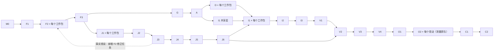

# M2S 流水线 v3 探索：从"主 Agent 编排"到"任务板 + 团队协作"

> **状态**：粗略的探索稿（2026-10-30），不是设计。§8 的问题正在逐条讨论，已定的标在 §8 里。基于 v2 草案（`PIPELINE_REDESIGN_v2.md`，commit 43f5c59）。
> 模块编号（M0/F/G/J/A/D/I/V/O/C/U）、术语（裁判、增量测试、事实库、缺口清单、裁定通道……）都沿用 v2。

---

## 0. 先说结论

1. **适合团队模式的只是一部分，而不是整条流水线。** 我们的流水线依赖很多，而且有严格的先后顺序。Anthropic 自己的文档也说，团队模式最适合**互相独立**的工作；顺序依赖多的工作，用单会话或子 agent 更合适。所以 v3 不应该是"一群 agent 自由讨论"，而应该是三部分：
   - 一个**带依赖图的任务板**；
   - 由**确定性的调度器**发布任务；
   - **少数几个讨论室**，用于确实需要对话的场合（规格问题、对抗评审）。
2. **任务发布 + 认领可行，粒度取中等。** 粗粒度的阶段任务（"写完整个代码"）几乎没有并行空间；但按单个接口、单个函数拆又太碎，协调开销和重复读代码的成本会超过收益。建议按**工作包**拆：几个相关接口一组，由工具在结构提取后机械分组（§3.6）。
3. **公告板可以代替主 Agent 转发消息，但不能代替判定。**
   - 进度、产物更新、问题提出，可以直接发到公告板，不经过主 Agent；
   - 任务是否完成、裁判是否冻结、裁定结论，仍然由工具或指定的裁定者给出；
   - "谁能看到什么"必须由工具强制执行（比如增量测试不能被实现者看到），不能只靠提示词约定。
4. **主 Agent 降级成"异常处理者"。** 日常调度交给确定性的调度脚本，LLM 只处理判断不了的情况：分诊结果为"未定"、讨论室超过轮数、任务反复失败。
5. **底座分三层。** 协调层（任务板、依赖图、消息、文件租约）**已定：直接采用 Beads + mcp_agent_mail**（2026-10-30），由我们的 MCP 服务补上完成检查、失效传播、可见性和资源锁（§6.4）。这样执行 agent 的底座就可以替换：继续用 OpenHarness，或者换成 Claude Code、Codex 的非交互模式，或者用 Microsoft Agent Framework / LangGraph 写的 worker。Claude Code 自带的 Agent Teams 功能最完整，但**必须在交互式会话里运行**，不适合无人值守的长时间运行，比较适合流水线升级时有人在场的对抗评审。

---

## 1. v2 的编排方式和痛点

v2（以及 v1）是**中心编排**：主 Agent 按编排协议一次派发一个子 agent；子 agent 通过工作区文件交接；主 Agent 调用 gate 工具复核，决定下一步或回炉。子 agent 之间不直接通信。

实际运行中遇到过的问题（来自 v1 的 E0 运行记录）：

| 问题 | 根源 |
|---|---|
| 主 Agent 的某次回复只有文字、没有调用工具，`oh -p` 进程就结束了，整个运行中断 | 调度依赖 LLM 的每一轮回复 |
| 主 Agent 用完 `max_turns`，只能人工补跑收尾 | 一个 LLM 会话要从头到尾撑完整条流水线 |
| 进程被 OOM 杀掉、API 中断，只能靠 TODO.md 人工续跑 | 没有持久化的执行状态 |
| 主 Agent 自己持有的长期 MCP 进程用着旧版代码，gate 判错 | 调度者和工具进程的生命周期绑在一起 |
| 每个子 agent 派发后要轮询（间隔 ≥30 秒），派发之间还要冷却 | 编排是串行的 |
| 可以并行的工作也在串行执行：裁判线和设计线、各个接口、各个函数 | 一次只派发一个子 agent |
| 每个反馈都要经主 Agent 转发（规格问题 → architect → 回到 V1） | 没有直接通道 |

前四个是"**LLM 当调度器**"带来的问题，后三个是"**中心串行**"带来的问题。团队模式主要解决后者，前者要靠确定性调度和持久化状态来解决。

---

## 2. 哪些模块适合团队模式

| v2 模块 | 可并行的粒度 | 需要讨论吗 | v3 建议 |
|---|---|---|---|
| F1 结构提取 | 无（脚本） | 否 | 保持为工具任务 |
| F2 语义标注 | **每个接口** | 否 | 按接口拆成任务，多个 annotator 认领 |
| F3 出处检查 | 每个接口 | 否 | 作为每个 F2 任务的完成检查 |
| G 缺口盘点 | 按缺口类别 | 少量 | G1 工具任务 + G2 按类别拆分 |
| J1 黑盒用例 | **每个接口** | 否 | 按接口拆分 |
| J2–J5 运行单体、对账、白盒、变异 | 每个接口；运行单体要用共享资源 | J3 对账有争议时需要 | 工具任务；有争议的差异进入**规格讨论室** |
| A 设计 | 基本不可拆（全局设计） | **是**：和裁判线、事实库之间 | 一个 architect；规格问题通过讨论室和 verifier、annotator 直接沟通 |
| D 增量测试设计 | **每个函数** | 偶尔 | 按函数拆分；必须在对应函数的 I1 之前完成 |
| I1 写代码 | **每个函数**（共享层除外） | 偶尔（共享层、接口约定） | 按函数拆分，每个任务只拥有自己的目录；共享层单独作为一个任务，被其他任务依赖 |
| I2 写模板 | 不可拆（一个文件） | 否 | 一个任务 |
| I3 一致性检查 | 不可拆 | 否 | 一个任务 |
| V 验收 | 按函数运行；判定是全局的 | 分诊有争议时需要 | 工具任务；分诊不了的进入**分诊讨论室**，或交给异常处理者 |
| O1 诊断 | 按规则、按函数 | 否 | 拆分 |
| O2 小范围改动 | **每个改动**的编写可以并行；性能测量在 AWS 上实测（§5.1） | 否 | 编写并行；每个候选改动部署成独立的栈，测量按压测客户端排队 |
| O3/O4 架构申请、交给人 | — | **是** | 讨论室或人 |
| U3 规则压测 | 每个对抗评审 | **是**：这就是辩论 | 最适合"真正的团队模式"，可以直接用 Claude Code Agent Teams |

注：表里的"每个接口""每个函数"是**最细**能拆到的粒度。实际任务按 §3.6 的工作包组织。

---

## 3. 任务发布 + 认领 + 依赖图

### 3.1 任务从哪里来

1. **流水线模板**（静态部分）：每个应用都有的固定任务和依赖，比如 M0 → F1 → … → C2。
2. **动态展开**：
   - F1 完成后，按工作包展开 F2、J1；
   - A 完成后，按蓝图的工作包展开 D 和 I1；
   - O1 完成后，按改动请求展开 O2。
   展开由调度器机械完成，不由 LLM 决定。
3. **运行中新增**：回炉任务、规格问题的裁定任务、补测任务。agent 可以**申请**新增任务，但要经过任务板工具的检查（类型、依赖、权限）才会真正创建。

### 3.2 任务字段（草案）

```json
{
  "id": "I1:flights",
  "kind": "I1",
  "scope": {"package": "flights", "functions": ["flights-search", "flights-get-flight", "flights-reserve-seat", "flights-release-seat"], "paths": ["output/lambdas/flights/"]},
  "role": "code-developer",
  "deps": ["A", "D:flights", "J6", "I1:shared-layer"],
  "inputs": [{"artifact": "blueprint", "version": 3}, {"artifact": "judge", "version": "1.0"}],
  "outputs": ["output/lambdas/flights/"],
  "done_check": {"tool": "run_gate", "args": {"phase": "code", "package": "flights"}},
  "resources": [],
  "status": "blocked",
  "lease": null,
  "attempts": 0,
  "max_attempts": 2,
  "feedback": []
}
```

几个关键字段：
- `scope.paths`：这个任务**独占**的文件范围，用来防止两个 agent 改同一个文件；
- `inputs` 带版本号：上游产物（比如事实库）被修正后，用旧版本做的下游任务自动标为"失效"，重新进入待办（见 §5）；
- `done_check`：完成由工具判定；
- `resources`：需要独占的共享资源，比如 `measure`（性能测量）、`docker-rie`（运行环境池）、`ws-git`（提交锁）。

### 3.3 状态机

```
blocked ──依赖全部完成──► ready ──认领（拿到租约）──► claimed ──提交──► checking
   ▲                       ▲                            │                  │
   │                       │ 租约过期 / 主动放弃          │                  ├─ 检查通过 → done → 解锁下游任务
   │                       └────────────────────────────┘                  │
   │                                                                       └─ 检查失败 → 写入反馈，attempts+1
   │                                                                              ├─ 未到上限 → ready
   └── 上游产物版本变化 → stale → 重新进入 blocked/ready                          └─ 到上限 → needs_human
```

和 Claude Code Agent Teams 的任务表相比，多了两样东西：
- **`checking` 状态**：提交后由工具判定，不允许 agent 自己把任务标为完成。Claude Code 用 `TaskCompleted` hook 返回退出码 2 来拒绝完成，是同一个思路；
- **`stale` 状态**：上游变了，下游自动失效。

### 3.4 认领规则

- **按角色认领**：任务只能被对应角色的 agent 认领。例如 `D:*` 只能由 verifier 认领，`I1:*` 只能由 code-developer 认领。
- **租约 + 心跳**：认领时拿到一个租约，定期续约；过期就自动释放。这样崩溃或被 OOM 杀掉的 agent 不会让任务卡死。
- **文件独占**：两个已认领任务的 `scope.paths` 不能重叠。参照 mcp_agent_mail 的文件租约，但由我们的工具**强制执行**，不只是建议。
- **资源锁**：参照 Claude 迁移文章里"只有一个 build daemon 能重建二进制"的做法：
  - `aws-load-client`：每台压测客户端一次只跑一个测量；
  - `aws-infra-stack`：e2e 共用的基础设施栈要串行操作（以前两个运行同时操作它，发生过冲突）；
  - `aws-concurrency`：同时在测的栈共用账号的 Lambda 并发额度（目前是 1000），按额度计数；
  - `docker-rie` 是固定大小的池；
  - 工作区 git 的提交串行进行。

### 3.5 依赖图示例（一个应用）



和 v2 相比，关键路径变短的地方：
- **J 和 A 并行**（v2 已经允许，但串行编排做不到）；
- **各工作包并行**；
- O2 的改动编写并行，只有测量排队。

### 3.6 任务粒度：工作包（框架和补充规则已定 2026-10-30；更好的分组方法列为待办，见 §9）

**前提**：分组只影响效率和标注的一致性，不影响正确性。每个任务的完成检查是按接口做的，裁判是全局的，分错组最多是多读几遍代码。所以分组可以用启发式规则，但规则必须是确定的，结果要记录下来。唯一会影响质量的是"同一段共享代码被不同的包标得不一致"，这由第 5 条规则处理。

**为什么不按单个接口拆。** 7 个应用各有 8–30 个接口、6–26 个函数。并发的 worker 一般只有 3–5 个（这是 Anthropic 的建议），任务数比 worker 数多出两倍以上，并行收益就不再增加。每个任务还要重新读一遍路由文件、服务层代码和规则，按接口拆会把同一段代码读 N 遍。Airbnb 的经验也是"同目录的兄弟文件是最好的上下文"。同组的接口共享业务规则，放在一起标注也更容易保持一致。

**现成的分组办法**

| 办法 | 出处 | 放到我们这里 | 局限 |
|---|---|---|---|
| 按源文件 | Airbnb（每个文件一个状态机）；Anthropic 的队列以"输出文件存在"表示完成 | 按单体的路由文件分组 | airline、coffee、shopping-cart 的接口全在一个文件里 |
| 按 REST 资源（URL 第一段） | REST 设计惯例 | `/flights/*`、`/cart/*` 各一组 | acmeair 有 9 个 `/config/*` 管理接口，需要人为合并 |
| 按业务能力 / 数据归属 | DDD 的限界上下文；Dehghani 的"数据跟着服务走" | 按调用的服务模块或访问的表分组 | 公共的 users 表会把所有接口连成一片，要排除这类"枢纽表" |
| 按共同执行的代码聚类 | Mono2Micro（IBM，按业务用例的运行轨迹给类聚类） | 用 F1 的静态调用图代替运行轨迹 | 实现成本高，对 8–30 个接口的应用不划算 |
| 按依赖层次（先叶子后上层） | Anthropic 的移植按依赖顺序排队 | 已经用于"共享层 → 各函数" | 只决定先后，不决定怎么分组 |
| 固定大小的批 | 通用做法 | 每 N 个接口一组 | 不考虑业务，容易把相关接口拆散 |

**当前 7 个应用按 URL 第一段分组的结果**（数据来自各工作区的 `analysis_report.json`）：

| 应用 | 接口 | 按 URL 第一段 | 按路由文件 |
|---|---|---|---|
| airline-booking | 18 | flights 4、bookings 4、payments 3、loyalty 2、auth 4、customers 1 | 1 个文件 |
| bookstore | 15 | auth 4、cart 5、books 2、orders 2、search 1、bestsellers 1 | 6 个文件，和 URL 分组一致 |
| ecommerce | 30 | orders 6、warehouse 6、delivery 5、payment-3p 5、auth 4、products 3、payment 1 | 7 个文件，和 URL 分组一致 |
| coffee | 10 | orders 4、qr-code 2、其余 4 个各 1 | 1 个文件 |
| shopping-cart | 10 | cart 6、product 2、auth 2 | 1 个文件 |
| todo | 8 | item 6、register 1、login 1 | 2 个文件 |
| acmeair | 25 | config 9、bookings 3、login 2、customer 2、loader 2，其余 7 个零散 | 2 个文件（21 + 4） |

**规则**：由工具在 F1 之后机械执行，结果写进任务板。以下 8 条都已定（2026-10-30）。其中第 1、3、4、5、7 条是为 acmeair 这类复杂单体补充或升级的。实现时还要定两件事：
- 第 5 条：事实库里"引用共享条目"的结构；
- 第 7 条：J2 能否按用例分别记录覆盖率。

1. **先分出运维类接口**（新增）。条件是：路径里有 status、health、check、metrics、config、loader、admin、stream 这类词，不需要登录，也不写业务数据。每个应用的运维类接口合成一个包。
   - 这一步只决定分组，不决定接口要不要保留。保留与否仍由 architect 按"迁移带来的变化"裁定。
   - 会误判。例如 coffee 的 `/config` 读的是业务配置表。误判只影响分组，不影响保留与否的裁定。
2. **登录、注册、会话接口合成一个身份包**，分属不同进程也合在一起。原因是它们涉及身份映射，归入"迁移带来的变化"。
3. **业务接口按亲和关系合并**（升级）。以 URL 第一段作为初始分组，两组之间只要有下面任一种联系就合并：
   - 共用一张非枢纽的表或集合；
   - 共用一个非枢纽的辅助函数；
   - 一方的请求字段或存储字段引用了另一方的实体 ID（例如 `toFlightId` 引用 flight）。

   被一半以上业务接口用到的表、文件、中间件算作"枢纽"，不作为合并依据。原来的"同一个路由文件、同一个服务模块"也属于亲和关系；当整个应用只有一个文件时，这个文件就是枢纽，自动失效。
4. **大小按代码量算**（升级）。代码量 = 处理函数，加上它能到达的、非共享代码的行数。预算按 worker 上下文的一定比例设定，接口数只作为上下限。
   - 超出预算的组，从亲和关系最弱的地方拆开；
   - 没有任何联系的小组，并入最小的相邻组。
5. **共享代码单独成任务**（新增）。被 2 个以上包用到的代码（比如会话检查中间件、数据访问层），由一个 `F2:shared` 任务统一标注，各个包引用它的条目。这样同一条规则不会在不同的包里标得不一致。前提是事实库支持"引用共享条目"，这是一个结构改动，待定。
6. **接口少于 10 个的应用（todo），整个应用只算 1–2 个包**，不必拆。
7. **J3 之后可以重新分组一次**（新增）。J2 运行单体时，按用例分别记录覆盖率，再和事实库里的数据访问位置对照，就得到每个接口实际执行的代码和访问的表。用这些数据重新分组，但只影响还没展开的任务（D、I1 的后备分组，以及 A 的参考输入），已经完成的任务不动。
   - 按用例分别记录覆盖率的办法：Node 用 inspector 的 `Profiler.takePreciseCoverage`，Python 用 coverage.py 的 `switch_context`。能否集成进 J2，待验证。
8. **设计完成以后（D、I1），工作包改按蓝图的领域目录划分。** 如果蓝图把所有函数放在同一个目录里（acmeair-a2、bookstore-oh、todo-oh 都是这样），就按"接口 → 函数"的对应关系，沿用单体那一侧的工作包。

#### 放到 acmeair 上

**现在的 F1 在 acmeair 上几乎拿不到分组信号。** 2026-10-30 检查了 `acmeair-a2/storage/analysis_report.json`：
- 25 个接口的 `cross_file_calls` 全部为空，`data_access` 也全部为空；
- `call_graph` 只有 6 条边，都是 hystrix 模块的模块级调用。

原因是 acmeair 的写法：
- 路由对象由工厂函数创建：`new require('./routes/index.js')(dbtype, authService, settings)`；
- 处理函数以对象成员的形式注册：`routes.bookflights`；
- 数据访问层在运行时按 `dbtype` 选择（`dataaccess/mongo|cassandra|cloudant`），集合名以参数形式传进通用函数 `findBy`、`insertOne`。

**但信号其实就在同一个文件里**：
- 处理函数都按名字调用同文件里的辅助函数；
- `source_data_store` 已经列出了每个集合的访问位置（文件:行号）。

只要沿同文件的函数名解析 1–2 层，就能得到每个接口访问的集合。已核实的例子：
- `bookflights`（170–194 行）→ `bookFlight`（498 行）→ `insertOne` booking（505 行）；
- `queryflights`（117 行）→ `getFlightByAirportsAndDepartureDate`（418 行）→ `findBy` flight（446 行），再 → `getFlightSegmentByOriginPortAndDestPort`（468 行）→ `findBy` flightSegment（480 行）；
- `login` → `validateCustomer`（customer 集合）、`createSession`（customerSession 集合）。

**已定：这个解析做进 F1**（2026-10-30）。它的作用不止是分组：现在 acmeair 事实库的 `data_access` 是空的，裁判线要到 J3 对账时才会发现这个缺口；在 F1 里补上，可以提前填上事实库。

实现时要改的地方（2026-10-30 读代码确认，**还没改**）：
- **`spec_extract.py` 的 `_extract_data_access`**：
  - 只识别 DynamoDB 的调用；
  - 对同文件辅助函数，只在已经进入其他模块之后才跟进（深度 ≥1）。从处理函数本身出发时，它不跟同文件的辅助函数。

  要改成：从处理函数出发，就跟进同文件辅助函数 1–2 层。
- **MongoDB**：
  - 现状：`data_store.py` 已经能解析通用的数据访问包装函数。在 acmeair 上，它得到 26 条访问模式，每条都带调用位置，但没有挂到具体接口上。
  - 要改成：把每个接口的调用链和这些调用位置对上，写进这个接口的 `data_access`。
- **`spec_extract_py.py`**（Flask 版）：还没检查是否有同样的问题，实现时一并核对。

**为什么第 1 条和第 3 条的枢纽规则是必需的**：
- `/loader/load` 会写入 customer、flight、flightSegment、airportCodeMapping 4 个集合；
- 6 个 `count*` 接口分别读取各个集合；
- 会话检查中间件挂在 11 个业务接口中的 6 个上，都会访问 customerSession。

如果不先把运维类接口分出去，也不排除枢纽，所有业务接口都会因为共用集合被连成一个包。

**按升级后的规则，acmeair 的分组（估算）**：

| 包 | 接口 | 合并依据 |
|---|---|---|
| 身份 | 主程序的 login、logout；authservice 的 `/byuserid/:user`、`GET /:tokenid`、`DELETE /:tokenid`（共 5 个） | 规则 2；共用 customerSession 集合 |
| 航班和预订 | queryflights、bookflights、cancelbooking、`bookings/byuser`（共 4 个） | bookflights 的 `toFlightId` 引用 flight |
| 客户 | `customer/byid` 的 GET 和 POST（共 2 个） | customer 集合。`bookings/byuser/:user` 也引用用户 ID，所以可以并入上一个包 |
| 运维 | config 下 9 个、loader 下 2 个、checkstatus、hystrix.stream、authservice 的 status（共 14 个） | 规则 1。按接口数看超了上限，但处理函数大多只有几行，按代码量算并不超 |

一共 3–4 个包。另外 6 个应用的分组和原规则基本一样，每个应用大约 2–6 个包。

#### 比 acmeair 更大的单体（以后再做）

接口到了上百个时，瓶颈会转到只有一个上下文的模块：
- **A 设计**：拆成 A0 和 A:领域。A0 负责全局：领域划分、数据归属、跨领域接口约定、共享基础设施，参考输入是工作包和 J2 得到的实际访问记录；A:领域 负责各领域内的函数设计。这里正好可以落实之前暂存的 Dehghani"数据跟着服务走"的要点。
- **I2 模板**：按领域分片编写，再由工具合并。airline-booking-c3 已经有 `template.part1.yaml` 和 `template.part2.yaml`，说明分片写已经在发生。
- **G 缺口盘点**：按工作包拆分。

---

## 4. 公告板和讨论室：不必事事经过主 Agent

### 4.1 三种通信方式

| 方式 | 用途 | 例子 | 谁能写、谁能读 |
|---|---|---|---|
| **任务板** | 工作本身 | 任务的创建、认领、提交、完成、失败反馈 | 工具维护状态；agent 通过工具认领和提交 |
| **公告板（事件流）** | 状态变化的通知，只追加 | "事实库 v4 发布（修改了 3 个接口）""裁判 1.0 已冻结""SI-7 已提出""任务 I1:orders 第 2 次失败" | 工具和 agent 都能发；**按主题和角色过滤可见性** |
| **讨论室** | 需要来回对话才能解决的问题 | 规格讨论室（verifier、architect、annotator）；分诊讨论室；对抗评审室 | 只有被邀请的角色；**轮数有上限**；结论必须通过工具写进裁定记录才算数 |

### 4.2 原来经过主 Agent 的事情，v3 由谁处理

| v2 中由主 Agent 做的事 | v3 由谁做 |
|---|---|
| 决定下一步派发谁 | 调度器：依赖满足就把任务设为 `ready`，空闲的 worker 去认领 |
| 运行 gate 复核 | 任务板的完成检查（提交时自动调用工具） |
| 转发规格问题给 architect，再把裁定转回 V1 | 规格讨论室 + 公告板（裁定发布后，相关任务自动解锁或失效） |
| 回炉：拼接报告重新派发 | 检查失败时，反馈直接写进任务的 `feedback`，任务回到 `ready` |
| 判断该退回哪个模块 | 先用机械规则（§4.11 的分诊表）；判断不了的进入分诊讨论室；还不行就交给异常处理者，最后交给人 |
| 检查工具有没有被改 | 任务板工具在每次提交时检查 |
| 打 tag `B0`、归档 | 调度器 |

**主 Agent 剩下的职责**是异常处理：`needs_human` 之前的最后一道 LLM 判断、讨论室超过轮数时的收口、整体进度报告。它不再需要从头到尾撑完一个会话，按需启动即可。

### 4.3 可见性必须由工具强制执行

**v2 的规则，以及现在靠什么保证**

| 规则 | v2 靠什么保证 | 有没有真正的强制 |
|---|---|---|
| 增量测试的设计者看不到实现代码 | 顺序：D1 排在 I1 之前，那时代码还不存在 | 有，但只在严格串行时成立 |
| 增量测试不对实现线开放（v2 Q2 暂定） | 实现线的提示词里不写 | **没有**：文件就在工作区里 |
| 裁判对实现线可读、可运行、不可改 | 冻结后比对 hash | 有：改了一定会被发现 |
| 运行中不读其他应用的归档记录 | 约定 | **没有** |
| 保留用例只在验收时运行（v2 Q1，后续扩展） | 还没实现 | 要真正藏起来，否则指标失去意义 |

**为什么现在不是真正的强制**：
- OpenHarness 的 agent 级权限不起作用；
- 按路径限制的规则只检查带路径参数的工具；
- agent 有 bash，直接 `cat` 文件就绕过了（见 v1 设计 §3.1）。

"不能改"可以靠 hash 事后发现，"不能看"却无法事后发现。

**v3 让这个问题更突出**：
- **顺序保证变弱**：各工作包并行以后，D:包B 运行时，I1:包A 的代码和共享层可能已经在磁盘上了。
- **回炉时**：增量测试的文件已经存在，code-developer 回炉时可以读到。这个问题 v2 也有。
- **新增的通道**：
  - 公告板；
  - 任务的 `feedback` 字段（完成检查的失败输出可能带着断言细节）；
  - 分诊讨论室：verifier 和 code-developer 在同一个房间里讨论增量测试的失败。

**可选做法（待定）**：

| 做法 | 能防住什么 | 局限 |
|---|---|---|
| A. 修好 OpenHarness 的权限 | 文件工具的越权读取 | bash 仍然能绕过；靠拦截命令来限制 bash 很容易漏掉（`python -c`、`node -e`、`Get-Content` 等写法都能读文件） |
| B. 敏感资产移出工作区，只由 MCP 服务读取，工具按角色过滤 | agent 随手读文件（工作区里根本没有这些文件，工具输出也不暴露路径） | 用的是同一个系统用户，知道路径照样能读，所以只是隐藏，不是隔离 |
| C. worker 放进沙箱（容器或单独的系统用户），只挂载自己有权访问的目录 | 真正的隔离 | 本机 Docker 一直不稳定；成本最高 |
| D. 事后检测：<br>- 用 hook 记录所有文件工具的路径和 bash 命令；<br>- 在敏感文件里埋入金丝雀标记，扫描 worker 的输出和记录 | 能证明"没有泄漏"；发现泄漏时，作废该任务的结果并重跑 | 不能阻止，只能发现；读了但没有复述出来的情况，只能靠命令记录发现 |

**已定：A，修好 OpenHarness 的权限**（2026-10-30）。

2026-10-30 读了 OpenHarness 的代码（`permissions/checker.py`、`tools/agent_tool.py`、`swarm/spawn_utils.py`），现状如下：
- 检查器本身已经支持四种规则：工具允许名单、工具禁止名单（`allowed_tools` / `denied_tools`）、路径规则（`path_rules`），以及按通配符匹配整条命令的禁止规则（`denied_commands`）。禁止规则在 `full_auto` 模式下也生效。
- **问题 1**：agent 定义里的 `permissions` 在派发时传进去了（`agent_tool.py`），但启动子进程时只带上了 `--permission-mode`（`spawn_utils.py`），所以 agent 级的权限没有生效。
- **问题 2**：路径规则和命令规则都是全局设置，不能按 agent 或按任务分别设置。
- **问题 3**：路径规则只检查带 `file_path` 参数的工具调用。bash 内部读了哪些文件，它看不到。

要修的范围（还没改）：
1. **按每次派发生成权限设置**：调度器为每个 worker 生成一份权限设置，通过启动参数或设置文件传给子进程，并让 agent 定义里的 `permissions` 真正生效。
2. **路径规则分读和写**：
   - 写：只允许写自己任务的 `scope.paths`。这同时也把"文件独占"从建议变成了强制。
   - 读：禁止读受保护的资产，包括增量测试（对实现线）、其他应用的归档、保留用例。
3. **bash**：
   - 不需要 shell 的角色，直接禁止 bash；
   - 需要 shell 的角色，用 `denied_commands` 禁止提到受保护路径的命令，同时禁止直接调用任务板的写命令（见 §6.4）。

**剩下的风险**：
- 递归命令（`grep -r`、`find`）不会写出受保护路径的名字，却会读到工作区里的受保护目录。
- 用拼接字符串的方式写路径，也能绕过命令规则。

成本最低的补救是把受保护资产放在 worker 的工作目录之外，也就是上面的 B。要不要补，等实现时再定。

讨论室和公告板里的转达格式，沿用 v2 退回实现线的规定：只给失败的函数、出处、期望和实际结果，不给用例的原文。

### 4.4 讨论室（已定：三个都做，2026-10-30）

| 讨论室 | 议题（一室一题） | 参与者 | 谁拍板 | 关闭时写什么 | 超过轮数后 |
|---|---|---|---|---|---|
| **规格讨论室** | 一个规格问题（SI），或 J3 对账中有争议的一条差异 | 提出方（通常是 verifier）、architect、annotator | 按 v2 的裁定通道（§4.12）：事实错误由 annotator 修正事实库，不需要裁定；放宽由 architect 决定；偏离单体缺陷由 architect 提出、人确认 | 事实库修订或裁定记录。调度器据此把用到旧版本的任务标为失效 | 交给人 |
| **分诊讨论室** | 一个机械分诊规则（v2 §4.11）判断不了的失败 | 嫌疑模块的角色（code-developer、sam-engineer、architect），加上 verifier 代表裁判一方 | 参与者都同意，就按共识；否则由中立的异常处理者判断。**参与者各有"不是我的问题"的倾向**，所以不能让其中任何一方拍板 | 归因结果；调度器给被归因的模块建一个回炉任务。如果争议在裁判的期望本身，就转去规格讨论室（分诊不能改裁判） | 交给人 |
| **对抗评审室** | U3：一条候选规则在试点应用上的压测 | 两个评审 + 一个仲裁，有人在场 | 仲裁提出，人批准 | 规则修正候选 | 人决定 |

对抗评审室要分两步，才能保住 Anthropic 文章里"两个评审上下文互相独立"的前提：
1. 两个评审各自独立写意见，**看不到对方的意见**；
2. 仲裁同时读两份意见，可以向任一评审追问；每个评审可以对另一方的意见反驳一次。

这个讨论室可以直接用 Claude Code Agent Teams 实现：团队必须在交互式会话里组建，而 U3 本来就有人在场，正好满足。另外两个讨论室在无人值守的运行中进行，要由我们自己的协调层实现。

**所有讨论室的共同约束**：
- 一室一题。关闭条件只有两种："结论经工具写入"，或"超过 N 轮"（沿用 v2 的往返最多 2 轮）。
- 参与者固定，不能临时拉人进来。（Claude Code 也不支持嵌套团队。）
- 讨论内容本身不算结论，只有经工具写入的结论才算。
- 讨论记录全部存档，作为裁定的依据。
- 可见性仍然按 §4.3 过滤。例如分诊讨论室里的 code-developer 不能看到增量测试的内容，verifier 引用时只能给出"失败的函数、出处、期望和实际结果"，和 v2 退回实现线时的转达内容一致。

### 4.5 主 Agent：完全去掉，还是保留常驻组长（已定：A + 两点补充 + 可选项，2026-10-30）

| | A. 完全去掉：确定性调度器 + 按需启动的异常处理者 | B. 保留常驻组长：一个长期运行的 LLM 会话盯着公告板 |
|---|---|---|
| 长会话问题（`max_turns`、只回复文字就退出、旧版工具进程、上下文压缩丢细节） | **根本上消除**：没有需要撑完整条流水线的会话 | 问题回来了。状态都在任务板里，所以组长崩溃后可以重启，但重启后也会丢掉它脑子里的上下文 |
| 结果的可复现性 | **高**：流程决策都是代码，只有 worker 的产出是随机的；比较两个 harness 版本时更干净 | 组长的优先级、归因、什么时候上报，都会改变流程，同一个应用两次运行之间的差异更大 |
| token 成本 | **低**：异常处理者每次只读一份案情材料 | 高，而且随运行时间增长：组长要持续读公告板，任务越细事件越多 |
| 跨任务的模式识别（比如 3 个 I1 任务都因为事实库里同一个字段写错而失败） | **弱**：每个异常各自冷启动，同类问题可能被当作几件事处理，甚至前后判断不一致 | **强**：组长看得到全局，能发现共同原因，暂停下游任务，直接去修上游 |
| 没预料到的情况 | 规则没写到的，都会上报给人；初期人工介入会更多；调度规则会越写越多 | 组长可以随机应变，上报给人的次数少 |
| 会不会退回"事事经过中心" | 不会：调度器不接收消息 | 有这个倾向：agent 习惯有事找组长，组长又会成为瓶颈。需要用工具强制限制 |
| 对论文叙述的影响 | 更像"工作流系统 + agent 作为 worker" | 更像"agent 团队" |

**结论：A 为主，补上 B 最有用的两点，外加一个可选项**：
1. **本次运行的处理记录**：异常处理者每次启动时，除了读案情材料，还读本次运行里它之前做过的判断和理由。这样同类问题的判断能保持一致，又不需要一个常驻会话。
2. **调度器做相似失败的归并**：按失败特征（同一条事实库条目、同一个错误签名）归并。归并到 2 个以上的失败，就作为一个异常交给处理者，并暂停同一个原因下游的任务。这就补上了"看得到全局"的能力。
3. **阶段边界复查**（可选）：在裁判冻结、B0 打 tag 这两个节点，各启动一次处理者，读阶段摘要。它只能新建任务或上报，不能改判定。

不管选 A 还是 B，组长或处理者的权限都一样：可以新建任务（经任务板检查）、关闭讨论室、在指定类别里做判断、上报给人；**不能**标记任务完成，也不能改裁判或增量测试。

---

## 5. 并发带来的新问题

| 问题 | 应对 |
|---|---|
| 两个 agent 改同一个文件 | 任务独占 `scope.paths`；共享层单独作为一个任务；I2 模板只有一个任务 |
| 上游产物变了，下游用的是旧版本 | 任务的输入带版本号；产物更新时，用旧版本的任务自动变成 `stale` |
| 性能测量互相干扰 | 改到 AWS 上实测，不再占用本机（§5.1）；在 AWS 上用压测客户端锁和并发额度控制 |
| Docker、DynamoDB Local、sam build 争抢资源 | 资源池 + 排队 |
| 结果的可复现性变差（执行顺序不确定） | 事件流完整记录；每个任务记录输入版本、执行 agent、模型；结果只依赖输入版本，不依赖执行顺序 |
| 讨论死循环 | 轮数上限 + 交给人 |
| token 成本上升（每个 worker 都要加载上下文） | 细粒度任务的上下文更小；Anthropic 建议团队规模 3–5 人；实验中记录 token |
| 隔离泄漏 | §4.3 |
| 实验可比性：v3 和 v2 的结果能不能直接比较 | 先跑一个"v3 调度、v2 顺序"的对照版本（P0），确认结果一致，再开放并行 |

### 5.1 性能测量改到 AWS 实测（已定，2026-10-30）

用户确认"必须在本地跑"的限制已经取消。仓库里已经有在 AWS 上测量的基础设施：
- `e2e_aws.py`；
- `e2e_ec2.py`：同区域 EC2 上运行 JMeter 压测；
- 指标采集和成本计算。

带来的变化：
- **两段式**：
  - 先在本机用代理指标筛选（调用次数、调用深度），结果确定、成本低；
  - 只有通过了裁判、代理指标也有改善的候选改动，才部署到 AWS 实测。这样可以控制 AWS 的费用。
- **每个候选改动一个栈**：
  - 部署可以并行，测量按压测客户端排队；
  - B0 的栈在 O 阶段一直保留；
  - 测量时 B0 和候选交替进行，抵消时段造成的漂移。
- **噪声规则**：
  - 每个测量重复多次；
  - 沿用现有报告的规则：去掉冷启动样本，样本少于 10 的标记出来；
  - 差异小于噪声阈值的，判为"无变化"。acmeair 的经验是：几毫秒的差异就是噪声。
- **负载必须覆盖改动的路径**：
  - acmeair 上 opt 的 `Promise.all` 从来没执行过，因为官方负载只订单程票，所以 v0 和 opt 的对比没有意义。
  - 测量时要用改动函数的调用次数，确认负载确实走到了改动的路径；没走到的，结果记为"未覆盖"，不是"无变化"。
- **测完拆栈，记录每次测量的费用。**

---

## 6. 底座选型

### 6.1 分成三层来看

| 层 | 职责 | 建议 |
|---|---|---|
| **协调状态层** | 任务板、依赖图、租约、资源锁、事件流、讨论室、可见性过滤 | **放进我们自己的 MCP 服务**（`m2s-server`），可以借鉴 Beads 和 mcp_agent_mail 的设计。这一层决定实验规则，必须由我们掌握 |
| **调度层** | 动态展开任务、启动 worker、处理租约过期、重启崩溃的进程、持久化执行状态 | 先写一个**确定性的 Python 调度器**。以后需要更强的持久化时，再换成 Temporal 这类耐久执行引擎 |
| **执行层** | 单个 agent 怎么调用模型、用工具、读写文件 | 可以替换：OpenHarness（现状）、Claude Code 或 Codex 的非交互模式、Microsoft Agent Framework 或 LangGraph 写的 worker |

### 6.2 候选比较

| 候选 | 能提供什么 | 和我们的需求的差距 |
|---|---|---|
| **OpenHarness（现状）** | 已有：每个 agent 的文件收件箱（`swarm/mailbox.py`，可按 `名字@团队` 发消息）、团队记录（`team_lifecycle.py`）、协调者模式、后台任务；支持 qwen；我们已经打过重试补丁 | 没有带依赖、可认领的任务表（`task_*` 工具管理的是后台进程）；agent 级权限不起作用；依赖 LLM 主 Agent 调度。**作为执行层继续用，协调层自己做**，改动最小 |
| **Claude Code Agent Teams** | 最完整的原生实现：<br>- 共享任务表有 pending / in progress / completed 三种状态，支持依赖，依赖完成后自动解锁；<br>- 自行认领，用文件锁防止抢同一个任务；<br>- 每个 agent 一个收件箱，成员之间直接发消息；<br>- 提供 `TaskCreated`、`TaskCompleted`、`TeammateIdle` 三个 hook，返回退出码 2 可以拒绝创建或完成，正好用来做 gate | **只能在交互式会话里组建团队**（`-p` 非交互模式和 Agent SDK 都不行）；不能恢复会话；一个会话只有一个团队；不能嵌套团队；任务状态有时会滞后。用 qwen 需要走阿里云的 Anthropic 兼容端点，**团队模式下能否正常工作还没验证**。适合 U3 对抗评审这类有人在场的短任务，不适合作为整条流水线的底座 |
| **Microsoft Agent Framework**（AutoGen 的后继，1.0 已于 2026-04 发布） | 图式工作流，显式控制执行路径；为长时间运行和人工介入提供状态管理；内置顺序、并发、移交、群聊、Magentic 等多 agent 模式；支持 MCP；支持多种模型提供方 | 要把现有 agent 定义和工具接入重写一遍；任务认领和租约仍然要自己做。官方的建议是"能写成函数的就别用 agent"，和我们"确定性调度"的方向一致 |
| **LangGraph** | 图 + 持久化检查点 + 人工介入中断；可以按接口、函数扇出并行；与模型无关 | 同上，要重写；讨论室要自己搭 |
| **Temporal** | 耐久执行：崩溃、限流、断网后从断点继续，重试策略可配置，正好对应"OOM、API 中断、只能人工续跑"的痛点 | 它不是 agent 框架，只是底座；要多运维一个服务。适合放到调度层，在 P3 阶段考虑 |
| **mcp_agent_mail + Beads** | 现成的"agent 身份 + 收件箱 + 文件租约 + 带依赖的任务表"，任何命令行 agent 都能通过 MCP 使用；有 git 审计记录 | 面向编码协作；文件租约只是建议性的；要适配我们的完成检查、可见性和资源锁。**可以直接借鉴设计，或者作为 P1 的原型** |

### 6.3 建议

- **近期**：
  - 执行层继续用 OpenHarness；
  - 协调层采用 Beads + mcp_agent_mail（已定，§6.4），`m2s-server` 只补适配部分；
  - 写确定性调度器，把 LLM 主 Agent 降为异常处理者。
- **后续扩展（不是当前重点，2026-10-30 定）**：执行层的可替换性可以作为一个实验。同一个协调层，分别接 OpenHarness、Claude Code 非交互模式、Codex 非交互模式的 worker，比较它们的效果和成本。
- **U3 对抗评审**：直接用 Claude Code Agent Teams，有人在场，正好发挥它的长处。
- **耐久执行**：等并行跑起来、运行时间变长以后，再评估是否需要 Temporal。

### 6.4 协调层：采用 Beads + mcp_agent_mail（已定，2026-10-30）

**选哪个版本**（2026-10-30 查的项目主页；版本变化快，实现前要再核对一次）：

| 组件 | 选项 | 建议 |
|---|---|---|
| mcp_agent_mail | Python 版已标为弃用，由 Rust 重写版 `mcp_agent_mail_rust` 取代。Rust 版：<br>- 有 Windows 构建和 PowerShell 安装脚本；<br>- 状态存在 SQLite，同时用 git 存档作为留痕；<br>- 新增了 build slot（`acquire_build_slot` / `renew_build_slot` / `release_build_slot`）；<br>- 自称还在 release candidate 阶段 | 用 **Rust 版**，固定版本号 |
| Beads | 有两条分支：<br>- **`bd`**（steveyegge → gastownhall/beads）：已经改用 Dolt 存储；内嵌模式只允许一个写入者，多个写入者要另外起 Dolt 服务；会自动提交 git、安装 git hook；有原子认领 `bd update --claim`；有 `beads-mcp`；支持 Windows。<br>- **`br`**（beads_rust）：保留经典的 SQLite + JSONL 结构；没有守护进程；从不碰 git；mcp_agent_mail_rust 的文档是配合它写的 | 倾向 **`br`**。原因：<br>- 不碰 git，不会干扰工作区的 git（我们要打 B0 tag，提交也要串行）；<br>- 没有守护进程；<br>- 和 agent_mail 是同一个生态。<br>Windows 支持和并发写入**待核实** |

**一个简化：worker 不直接写任务板。**
- 在 OpenHarness 上，worker 是调度器为每个任务启动的一次性进程（`oh -p`），不是常驻着等活的。所以"认领"实际上由调度器完成：把任务设为进行中、记下执行者，再启动 worker。这样也就不依赖 Beads 的原子认领了。
- 任务说明由调度器写进 worker 的启动提示词；worker 完成后调用 `m2s-server` 的提交工具。
- 只有调度器写 Beads。worker 直接调用 `br` 的写命令，要用 §4.3 的命令规则禁止掉。
- 以后如果出现常驻的 worker，再启用自行认领。

**需求和现成能力的对照**：

| 我们的需求 | Beads / agent_mail 现成提供 | 要补的部分（放在 `m2s-server` 和调度器里） |
|---|---|---|
| 任务、依赖、"依赖全部完成就可以开始" | Beads 的任务、`blocks` / `parent-child` 依赖、`ready` 列表 | 工作包用父任务表示，各模块任务作为它的子任务 |
| `checking` 状态：agent 不能自己把任务标为完成 | 没有 | worker 只能通过 `submit_task` 提交，之后调度器运行完成检查。检查通过，才由调度器关闭任务 |
| `stale`：上游产物变了，下游任务失效 | 没有 | 任务说明里记录输入产物的版本。产物版本更新时，调度器重新打开用到旧版本的任务，并写明原因 |
| 租约、心跳 | agent_mail 的文件预留带 TTL | worker 是调度器启动的进程，调度器直接看进程是否还活着，不需要心跳。进程崩溃了就把任务放回待办 |
| 文件独占 | agent_mail 的独占文件预留，加上提交前检查。但它只是**建议性的**：冲突会报告出来，预留请求本身仍然成功 | 用 OpenHarness 的写路径规则强制执行（§4.3）；agent_mail 的预留只用来留痕和展示 |
| 资源锁 | Rust 版的 build slot | 压测客户端、共用基础设施栈、`docker-rie` 池用 build slot（它是否支持"最多 N 个"，**待核实**）。账号并发额度由调度器计数 |
| 公告板 | agent_mail 的多收件人消息和 thread | 按角色列收件人，可见性靠"发给谁"来控制；每个应用一个独立的 project，满足"运行中不读其他应用的记录" |
| 讨论室 | agent_mail 的 thread；联系人策略可以限制谁能给谁发消息 | 一室一个 thread；参与者用联系人策略固定；调度器数轮次；结论必须通过 `m2s-server` 的裁定工具写入 |
| 事件流、留痕 | Beads 的 JSONL；agent_mail 的 git 存档 | 调度器另外写一份事件日志，记录每个任务的输入版本、执行者和模型，供复现使用；C2 归档时一并保存 |
| 可见性 | 没有：Beads 和 agent_mail 的数据，所有 agent 都能读到 | 规定：任务说明和消息里**只放指针和 v2 的转达格式**，敏感内容留在受保护路径里 |

**要先核实的点**（P0 开始前）：
- `br` 在 Windows 上能不能用；多个进程同时写的时候表现如何。
- agent_mail_rust 的 build slot 语义；它和 OpenHarness 的 MCP 配置能不能一起工作。
- 两个项目的版本稳定性。固定版本号，并让 `m2s-server` 的适配层薄一些，以后如果要换掉其中一个，只需要改适配层。

---

## 7. 粗略路线

| 阶段 | 内容 | 完成标志 |
|---|---|---|
| **P0 等价改造** | 先核实 §6.4 列出的几点；接入 Beads（`br`）和 mcp_agent_mail_rust；`m2s-server` 补上提交工具、完成检查、失效传播和事件日志；修好 OpenHarness 的权限（§4.3）；调度器按 v2 的顺序发布**粗粒度**任务，一次只放一个 | 在 bookstore 上得到和 v2 相同的验收结果；不再需要 LLM 主 Agent 撑完整个会话 |
| **P1 细粒度并行** | 动态展开（按接口、按函数、按改动）；J 和 A 并行；文件独占和资源锁 | 关键路径时长、token、返工次数和 P0 对比；验收结果一致 |
| **P2 公告板 + 讨论室** | 规格讨论室和分诊讨论室代替主 Agent 转发；按角色过滤可见性；异常处理者 | 主 Agent 介入次数下降；没有隔离泄漏（专门做泄漏测试） |
| **P3 更换底座的实验（后续扩展）** | 同一个协调层接不同的执行层；评估 Temporal | 各执行层的效果、成本对比 |

**评估指标**：
- 端到端时长；
- 关键路径时长；
- token 和费用；
- 返工次数；
- 主 Agent 和人工的介入次数；
- 裁判和增量测试的结果是否和 v2 一致（正确性不能下降）；
- 运行中断后能否自动恢复。

---

## 8. 待讨论问题

1. 主 Agent 是完全去掉（只保留确定性调度器 + 按需启动的异常处理者），还是保留一个常驻的"组长"？→ **已定：A + 两点补充 + 可选的阶段边界复查**（2026-10-30），见 §4.5。
2. 任务粒度：用户认为按接口、按函数拆太细（2026-10-30）。→ **已定**：工作包框架、针对复杂单体的补充规则（运维类接口先分出、亲和关系合并、按代码量定大小、共享代码单独成任务、J3 后重新分组），以及 F1 增加同文件辅助函数解析，见 §3.6。寻找更好的分组方法列为待办（§9）。
3. 讨论室要不要做：先只做规格讨论室，还是三个都做？→ **已定：三个都做**（2026-10-30），定义见 §4.4。
4. 可见性：先修 OpenHarness 的权限，还是把敏感资产移出 agent 能直接访问的目录？→ **已定：A，修好 OpenHarness 的权限**（2026-10-30）。修复范围和剩下的风险见 §4.3。
5. 性能测量的独占锁会不会让 O 阶段变成新瓶颈？要不要单独准备一台测量机器？→ **已定：改到 AWS 实测**（2026-10-30），见 §5.1。
6. 执行层的可替换性要不要作为论文的一个实验维度？→ **已定：列为后续扩展，不是当前重点**（2026-10-30）。
7. 协调层直接采用 Beads 和 mcp_agent_mail，还是自己实现？前者省事，但要适配完成检查、可见性和资源锁。→ **已定：直接采用**（2026-10-30）。版本选择、需求对照和待核实的点见 §6.4。

---

## 9. 待办

### 9.1 寻找更好的分组方法（2026-10-30 列入）

§3.6 的规则是启发式的，现阶段先用。往后要回答"有没有更好的分组"，需要先有衡量标准，再拿候选方法去比。

**衡量分组好坏的指标**（运行时记录）：
- 同一段代码被几个任务重复读取；
- 跨包引用的次数：一个包的标注或代码引用另一个包的条目；
- 同一条共享规则在不同包里标注不一致的次数；
- 返工次数，以及每次返工的原因是否和分组有关；
- 每个包的 token 消耗，以及各包之间消耗的差异；
- 关键路径时长。

**候选方法**：
- **按共同执行聚类**：参照 Mono2Micro，用 J2 按用例记录的覆盖率和数据访问情况，给接口聚类。前提是 §3.6 第 7 条的覆盖率采集能实现。
- **图社区发现**：把 §3.6 第 3 条的亲和关系做成带权图，用社区发现算法分组，取代"有联系就合并"的阈值规则。
- **LLM 提议、工具校验**：由 LLM 根据事实库提出分组，工具检查大小、枢纽排除、是否覆盖全部接口，校验通过才采用。分组结果要固定并记录，保证可复现。
- **按 architect 的领域划分倒推**：先做一版 A0 全局设计（§3.6 末尾"更大的单体"），再用它的领域给 F2 和 J1 分组。问题是 A0 要等事实库完成以后才能做，F2 和 J1 用不上，只能在后续的运行里使用。

**对照组**：按单个接口拆、只按 URL 第一段拆、当前的 §3.6 规则。

**数据**：现有 7 个应用规模偏小（8–30 个接口）。要真正比出差异，需要接口更多、分层更深的单体，可以和"以 acmeair 这类复杂应用为目标"一起规划。

---

## 参考

- Anthropic，Claude Code 文档：*Orchestrate teams of Claude Code sessions*，https://code.claude.com/docs/en/agent-teams
- Microsoft Agent Framework 概览：https://learn.microsoft.com/en-us/agent-framework/overview/
- mcp_agent_mail：https://github.com/Dicklesworthstone/mcp_agent_mail （Python 版，已弃用）；Rust 版：https://github.com/Dicklesworthstone/mcp_agent_mail_rust
- Beads（`bd`，Dolt 存储）：https://github.com/steveyegge/beads （现在指向 gastownhall/beads）；beads_rust（`br`，SQLite + JSONL）：https://docs.rs/crate/beads_rust/latest ；两者对比：https://gascity.com/guide/beads-vs-br/
- LangChain，*LangGraph vs Temporal*：https://langchain.com/resources/langgraph-vs-temporal
- 阿里云百炼，Claude Code 接入 Qwen：https://docs.platform.qianwenai.com/developer-guides/clients-and-developer-tools/claude-code
- OpenHarness 源码：`OpenHarness/src/openharness/swarm/`、`coordinator/`、`tools/task_*_tool.py`
