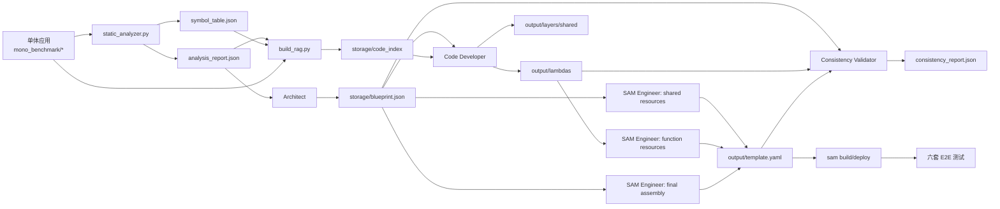

<!-- Mono2Sls-artifacts architecture analysis -->

# Mono2Sls-artifacts 项目架构分析

本文基于 `Mono2Sls-artifacts` 当前代码与论文
`MinerU_markdown_2604.24550v1_2097341777004748800.md` 整理。论文描述的是方法设计与实验结论；本文优先描述仓库中实际存在的目录、调用链和中间产物。

## 1. 项目定位

Mono2Sls 是一个“单体 Web 后端 -> AWS SAM Serverless 应用”的自动迁移流水线。它不是传统的源码转换器，而是把迁移拆成几个有文件契约约束的 LLM Agent 阶段：

1. 预处理器从单体项目提取路由、符号、依赖、调用图和数据库线索。
2. Architect 根据分析报告设计 `blueprint.json`。
3. Code Developer 根据蓝图生成 Lambda 代码和依赖。
4. SAM Engineer 将蓝图与代码组织成 `template.yaml`。
5. Consistency Validator 对代码、蓝图和 SAM 模板做跨产物检查并尝试修复。
6. 部署后 E2E 套件验证 API 行为、认证、数据隔离和异步最终一致性。

核心设计原则是：**Agent 之间主要通过磁盘文件通信，而不是通过长的任务上下文传递结果**。这使每个阶段可以清理上游上下文，降低长代码库迁移时的上下文窗口压力。

## 2. 顶层目录

```text
Mono2Sls-artifacts/
├── M2S/
│   ├── src/
│   │   ├── main.py                  # CrewAI 流水线入口和运行时控制
│   │   ├── config/                  # Agent 与 Task 的声明式配置
│   │   ├── preprocessor/            # 静态分析、代码 RAG 索引
│   │   └── tools/                   # 文件、RAG、SAM 校验工具
│   ├── knowledge/                   # AWS/SAM/Lambda/异步领域知识
│   ├── storage/                     # 分析报告、蓝图、向量索引
│   └── output/                      # 生成的 Lambda、Layer、SAM 模板
├── mono_benchmark/                  # 六个构造的单体基准应用
│   ├── todo/
│   ├── shopping-cart/
│   ├── bookstore/
│   ├── coffee/
│   ├── airline-booking/
│   └── ecommerce/
├── tests/                            # 六个与基准应用对应的 E2E 套件
└── README.md                         # 运行、部署和测试说明
```

目录职责可以归纳为四类：

| 层次 | 目录 | 作用 |
| --- | --- | --- |
| Pipeline runtime | `M2S/src` | 编排 Agent、执行工具、生成迁移产物 |
| Domain knowledge | `M2S/knowledge` | 为不同 Agent 提供受限的 AWS/SAM 知识 |
| Benchmark input | `mono_benchmark` | 作为迁移输入的单体应用 |
| Evaluation | `tests` | 对部署后的目标应用进行黑盒行为验证 |

## 3. 端到端数据流



### 3.1 主要文件契约

| 文件或目录 | 生产者 | 消费者 | 内容 |
| --- | --- | --- | --- |
| `storage/analysis_report.json` | 静态分析器 | Architect、部分任务 | 路由、依赖图、标签、配置和 DynamoDB 线索 |
| `storage/symbol_table.json` | 静态分析器 | RAG 构建器 | 函数/类的文件和行范围 |
| `storage/code_index/` | `build_rag.py` | Code Developer | 基于 CodeBERT 的代码向量索引 |
| `storage/blueprint.json` | Architect | Code Developer、SAM Engineer、Validator | 目标 Lambda、资源、认证和异步通信的单一事实源 |
| `output/lambdas/` | Code Developer | SAM Engineer、Validator | Lambda handler 与依赖 |
| `output/layers/shared/` | Code Developer | SAM Engineer、Validator | 可复用的 Lambda Layer |
| `output/template.yaml` | SAM Engineer | Validator、SAM CLI | AWS SAM/CloudFormation 模板 |
| `output/consistency_report.json` | Validator | 人工审查、实验记录 | 检查结果和修复摘要 |

## 4. Pipeline runtime

### 4.1 `main.py`：运行时控制层

[`M2S/src/main.py`](Mono2Sls-artifacts/M2S/src/main.py) 负责：

- 读取 `.env` 并检查部分 LLM 配置。
- 创建四个 CrewAI Agent。
- 从 `agents.yaml` 和 `tasks.yaml` 构建任务链。
- 对 CrewAI 的 LLM 调用增加限流重试，最多 5 次、指数退避，基础等待 30 秒。
- 在任务之间增加默认 15 秒冷却，可由 `INTER_TASK_COOLDOWN` 调整。
- 对关键任务执行后置文件校验，当前显式校验的是：蓝图中的每个 Lambda 是否在 `output/lambdas` 下生成了 handler。
- 顺序执行任务并输出耗时和生成物位置。

这里有一个重要实现特征：`context_clearing_tasks` 对代码生成、SAM 分阶段生成和最终验证任务设置 `context=[]`。因此后续 Agent 依赖 `storage/` 和 `output/` 中的文件，而不是依赖 CrewAI 的自然语言 task output。

### 4.2 Agent 与工具分配

配置位于 [`M2S/src/config/agents.yaml`](Mono2Sls-artifacts/M2S/src/config/agents.yaml)。

| Agent | 输入重点 | 工具 | 输出或职责 |
| --- | --- | --- | --- |
| Architect | `analysis_report.json`、必要的业务源文件 | `ReadFileTool`、`WriteFileTool` | `blueprint.json` |
| Code Developer | `blueprint.json`、原始代码、RAG 检索结果 | `ReadFileTool`、`CodeRAGTool`、`WriteFileTool` | handlers、依赖、共享 Layer、README |
| SAM Engineer | `blueprint.json`、生成代码目录 | 文件工具、`FileListTool`、`SAMValidateTool` | `template.yaml` |
| Consistency Validator | 蓝图、handlers、模板 | 文件工具、`FileListTool`、`SAMValidateTool` | 修复产物、`consistency_report.json` |

四个 Agent 都禁止 delegation。知识库按角色隔离：Architect 主要使用基础架构和异步模式；Code Developer 使用 Lambda 编码和异步模式；SAM Engineer 使用 SAM 模板参考；Validator 使用 SAM、Lambda 和异步知识。

### 4.3 `tasks.yaml`：实际任务拓扑

[`M2S/src/config/tasks.yaml`](Mono2Sls-artifacts/M2S/src/config/tasks.yaml) 实际上是 **7 个顺序任务**，而不是简单的“四个 Agent 对应四个任务”：

```text
architect_blueprint
		-> generate_complete_application
		-> generate_shared_resources_template
		-> generate_functions_template
		-> assemble_final_template
		-> validate_consistency
```

其中最后三个 SAM 任务属于同一个 SAM Engineer：

1. 先写共享资源：DynamoDB、Cognito、S3、API、Layer、SQS 等。
2. 再按 Lambda 目录和蓝图追加函数资源。
3. 最后追加 EventBridge 目标、权限、Outputs，并调用 `cfn-lint`。

这种拆分本质上是一个依赖有序的 IaC 构建过程，避免函数资源在共享逻辑资源尚未声明时引用不存在的 CloudFormation logical ID。

## 5. 静态分析器

实现位于 [`M2S/src/preprocessor/static_analyzer.py`](Mono2Sls-artifacts/M2S/src/preprocessor/static_analyzer.py)。它采用两遍式设计：

### 第一遍：文件级结构提取

- Python 使用 AST 识别函数、类、Flask/FastAPI 路由和 Flask Blueprint 前缀。
- JavaScript/TypeScript 使用正则识别 Express 的 `app.get`、`router.post` 等路由。
- 收集 `require`/`import` 依赖。
- 对源文件打标签：`AWS_SDK`、`DynamoDB`、`Auth`、`FileUpload`。
- 生成符号表，记录符号 ID、文件路径和起止行号。
- 解析根目录的 `requirements.txt` 和 `package.json`。

### 第二遍：跨文件调用图

Python 路径通过 AST 建立 import map，再识别函数体中的跨文件调用；JavaScript/TypeScript 路径通过相对模块 import 和正则扫描调用。每条边包含：

```json
{
	"caller_file": "routes/items.py",
	"caller_function": "get_item",
	"callee_module": "services.items",
	"callee_symbol": "get_item",
	"return_value_used": true,
	"is_awaited": false
}
```

`return_value_used` 与 `is_awaited` 是 Architect 判断同步调用、SQS 或 EventBridge 候选的重要静态信号。分析器进一步将边聚合成 `entry_point_dependencies`，让 Architect 可以按 endpoint 查询直接依赖，而不必从完整调用图重新搜索。

### 输出报告

`run_static_analysis()` 生成的报告主要包括：

- `project_structure`
- `entry_points`
- `dependency_graph`
- `file_tags`
- `call_graph`
- `entry_point_dependencies`
- `config_info`
- `dynamodb_info`

为了减少报告体积，CLI 会把 `symbol_table` 单独写入 `storage/symbol_table.json`，从 `analysis_report.json` 中移除。RAG 构建器会在报告缺少该字段时自动加载旁边的 `symbol_table.json`。

### 分析能力的边界

Python 分析使用 AST，通常比 JS/TS 正则路径可靠。JS/TS 路径支持 Express 常见写法和相对模块调用，但不能等同于完整 JavaScript/TypeScript 语义分析；动态路由注册、复杂别名、动态 import、跨文件重导出等情况可能漏报或误报。这是架构设计中的一个实际不对称点。

## 6. Code RAG

### 构建阶段

[`M2S/src/preprocessor/build_rag.py`](Mono2Sls-artifacts/M2S/src/preprocessor/build_rag.py) 使用静态分析得到的符号表来构造文档：

- 有函数/类符号的文件按符号边界切分。
- 没有符号的文件按 50 行窗口切分，窗口重叠 10 行。
- 支持 `.py`、`.js`、`.ts`、`.jsx`、`.tsx`、`.vue`。
- 使用 `microsoft/codebert-base` 生成 embedding。
- 使用 LlamaIndex `VectorStoreIndex`，持久化到 `storage/code_index/`。

### 查询阶段

[`M2S/src/tools/rag_tools.py`](Mono2Sls-artifacts/M2S/src/tools/rag_tools.py) 通过 LlamaIndex retriever 默认返回 Top-5 片段。`SimpleCodeFormatter` 只格式化原始检索节点，不调用第二个 LLM，因此解释和语义判断仍由 Code Developer 的主 Agent 完成。这避免了“RAG 工具内部再调用一次 LLM”的重复推理。

## 7. Architect 与 `blueprint.json`

Architect 的目标不是生成代码，而是建立后续阶段共享的架构契约。蓝图至少描述：

- 每个 HTTP 业务 endpoint 对应的 Lambda。
- Lambda runtime、源文件、认证要求和触发类型。
- DynamoDB、S3、Cognito、API Gateway 等共享资源。
- `lambda_invoke_permissions`：同步 Lambda 调用权限。
- `sqs_queues`：点对点异步队列及 DLQ 配置。
- `eventbridge_rules`：事件规则及消费者。
- `dropped_functions`：由 Cognito/API Gateway 等托管服务替代的认证端点。

通信决策遵循三类规则：

1. 调用方需要被调用方返回值，倾向同步 Lambda Invoke。
2. 单消费者、调用方不需要结果的副作用，使用 SQS。
3. 一个动作扇出到多个业务域消费者，使用 EventBridge。

任务提示还要求 Architect 区分 Worker Lambda 与 Orchestrator Lambda：默认把同一业务域代码放在 endpoint Lambda 内，仅把真正的异步副作用拆出，避免无必要的同步 Lambda 链和分布式事务复杂度。

## 8. Code Developer 输出

Code Developer 按蓝图严格生成每个 handler，通常采用：


- `output/lambdas/{domain}/{lambda_name}/handler.py` 或 `handler.js`。
- Python handler 使用 `lambda_handler(event, context)`。
- Node.js handler 使用 CommonJS `require/exports`。
- API Gateway 参数从 `pathParameters`、`queryStringParameters` 和 `body` 中读取。
- Cognito 身份从 authorizer claims 获取，而不是在 Lambda 中自行验证 JWT。
- 全局状态改为环境变量。
- 使用共享工具达到复用阈值时生成 `output/layers/shared/`。
- 只有存在非运行时依赖时才生成 `requirements.txt` 或 `package.json`。

这一阶段使用 CodeRAG 解决蓝图 `source_files` 未覆盖的 helper 或共享库定位问题，但代码生成的最终语义正确性仍然依赖 Agent 推理和后续 E2E 测试；RAG 本身不是业务等价性证明器。

## 9. SAM Engineer 输出

SAM 模板构建是增量式的：

```text
共享资源 -> Lambda Function 资源 -> EventBridge 目标/权限 -> Outputs -> cfn-lint
```

模板通常包含：

- `AWS::Serverless::Api`
- `AWS::Serverless::Function`
- `AWS::DynamoDB::Table`
- `AWS::S3::Bucket`
- Cognito User Pool/Client
- Shared Lambda Layer
- SQS Queue 与 DLQ
- EventBridge Rule
- Lambda permission 和 IAM policy

SAM Engineer 通过 `SAMValidateTool` 调用外部 `cfn-lint`。该工具负责模板级静态校验，不能发现所有“语法正确但代码与模板语义不一致”的问题，因此需要后面的跨产物 Validator。

## 10. Consistency Validator

任务配置中当前写的是 **12 个检查**，其中 `C7b` 是额外的 endpoint 认证覆盖检查，而论文正文概括为 11 项。当前配置的检查组为：

| 阶段 | 检查 |
| --- | --- |
| Structural | C1 目录与 Function 双向覆盖；C2 CodeUri 存在性 |
| Code/Template | C3 handler 有效性；C4 环境变量完整性；C5 IAM policy 对齐；C6 Layer 引用一致性 |
| Blueprint | C7 API 路径/方法匹配；C7b public endpoint 的 Auth override |
| Async | C8 SQS 资源、生产者和消费者；C9 EventBridge 规则、目标和权限 |
| Runtime | C10 依赖文件卫生；C11 Node.js CJS/ESM；C12 Node.js import/依赖解析 |

修复策略是批量处理错误后再次验证，并限制循环次数。需要注意：这些检查主要由 `tasks.yaml` 中的 Validator 行为规范驱动，仓库中没有看到一个独立的、完整实现 C1-C12 的确定性校验器模块。换言之，它们是“由 LLM 执行的检查协议”，而 `SAMValidateTool` 是独立的模板校验工具。这个设计灵活，但可重复性和可审计性弱于纯代码规则引擎。

## 11. Benchmark 与 E2E 评测层

`mono_benchmark/` 包含六个输入单体，覆盖 Python 和 JavaScript 两种主要运行时；`tests/` 中有六套同名 E2E suite。每套 suite 通常包括：

- `config/`：源单体合同、标准化业务合同、ground truth 和目标部署配置。
- `auth/`：Cognito provider 与 custom JWT provider。
- `tests/`：核心 CRUD、边界/健壮性、认证、隔离和异步语义测试。
- `run-target.js`：使用 Jest 对指定部署目标运行测试。

测试通过 provider 抽象统一不同认证方案：Mono2Sls 使用 Cognito，基线方法可以使用 custom JWT。这样测试可以把“业务行为”与“认证实现”分离，但认证兼容测试仍可单独评估。

测试重点不是本地函数单测，而是部署后黑盒行为：

- API endpoint 是否存在、路径和方法是否正确。
- CRUD 与错误输入行为是否保留。
- 用户之间的数据隔离是否保留。
- Cognito 或 JWT 认证是否符合目标方法约定。
- SQS/EventBridge 造成的最终一致性是否在等待窗口内出现。

## 12. 与论文的对应关系

| 论文描述 | 当前 artifact 对应实现 | 判断 |
| --- | --- | --- |
| 四阶段 Agent 流水线 | 4 个 Agent，7 个顺序 Task | 基本一致，代码把 SAM 拆成 3 个任务 |
| 静态分析驱动架构 | Python AST + JS/TS 正则、调用图、入口依赖 | 已实现，但 JS/TS 语义精度较弱 |
| CodeRAG | CodeBERT + LlamaIndex，retriever-only | 已实现 |
| 领域知识库 | 4 个 markdown 知识文件，按 Agent 分配 | 已实现 |
| SAM 校验 | `SAMValidateTool` 调用 `cfn-lint` | 已实现，属于模板级校验 |
| 11 项一致性检查 | `tasks.yaml` 当前明确列出 C1-C12 | 当前实现版本为 12 个检查编号 |
| 文件作为 Agent 间契约 | `analysis_report`、`blueprint`、`output` | 是项目最核心的工程实现 |
| Cognito 替代自定义认证 | Blueprint 规则和 SAM 提示中明确要求 | 目标架构已编码在提示中，最终质量仍需 E2E 验证 |
| 异步 SQS/EventBridge | Blueprint 字段、代码生成规则、SAM 资源规则 | 已形成跨阶段契约 |
| 100% 部署成功 | 论文实验结果 | 不能仅由静态阅读仓库复现，需要真实 LLM、AWS、SAM 和配置 |

## 13. 关键风险与架构判断

### 13.1 可重复性风险

Agent 的大量行为写在 YAML 提示中，Validator 也主要是提示驱动而非确定性代码驱动。相同输入不一定产生完全相同的蓝图、代码和修复结果；论文中的单次 pass@1 结果不能代表多次运行方差。

### 13.2 静态分析误差会向后传播

Architect 将 `analysis_report.json` 视为权威输入。如果入口点漏报、调用边误报或 JS 正则错误，错误会进入蓝图，再影响 handler、SAM 资源和 Validator。文件契约降低了上下文压力，但也放大了早期分析错误的影响。

### 13.3 模板正确不等于业务正确

`cfn-lint` 可以检查 CloudFormation/SAM 层面的错误，但不能证明：

- handler 的数据库逻辑等价于单体逻辑；
- 事件 payload 与消费者约定一致；
- 同步/异步选择满足业务返回值语义；
- DynamoDB 条件写、幂等性和最终一致性被正确保留。

这些问题只能由 Validator 的跨产物推理和部署后 E2E 测试部分覆盖。

### 13.4 跨 Lambda 同步调用被有意限制

任务提示默认偏向“本地包含同步业务代码 + 异步副作用拆分”，这是比机械地把每个服务都拆成 Lambda 更保守的迁移策略。它有助于保留单体事务语义，但也意味着论文中抽象的“按 endpoint 拆 Lambda”并不等于所有跨域调用都会变成独立 Lambda。

### 13.5 外部依赖较多

完整运行需要 Python 3.11+、CrewAI、LlamaIndex、HuggingFace embedding、Ollama、LLM endpoint、AWS SAM CLI、`cfn-lint`、AWS 账号和部署权限。仓库 README 是主要运行说明；当前 `M2S` 目录下没有发现 README 中所称的 `requirements.txt`，因此依赖安装可能需要按照 README 的替代命令或上层环境配置处理。

## 14. 一句话总结

Mono2Sls-artifacts 的本质是一个 **“静态分析提供结构事实，蓝图提供架构事实，多个专职 LLM 通过文件契约协作，SAM 与 E2E 层负责验证”** 的迁移系统。它的强项是把跨代码、架构和 IaC 的长程一致性问题拆开处理；它的主要薄弱点是静态分析在 JS/TS 上的近似性、LLM 驱动检查的非确定性，以及模板级验证与真实业务语义之间仍存在距离。
