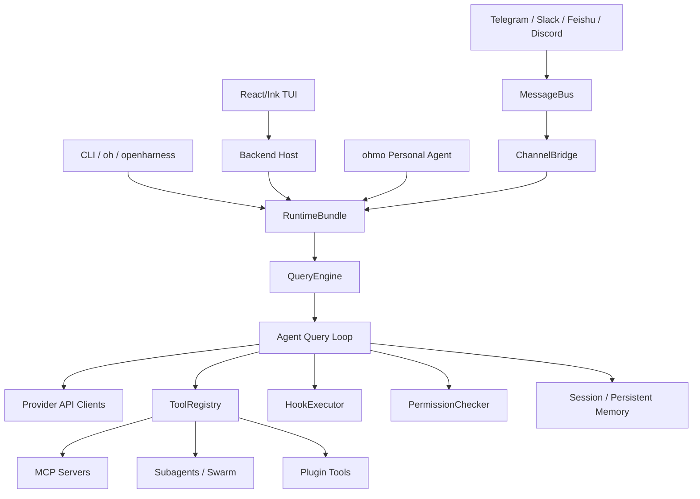
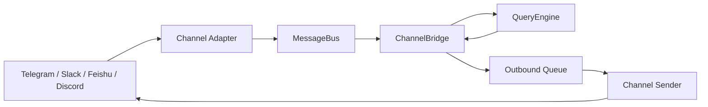
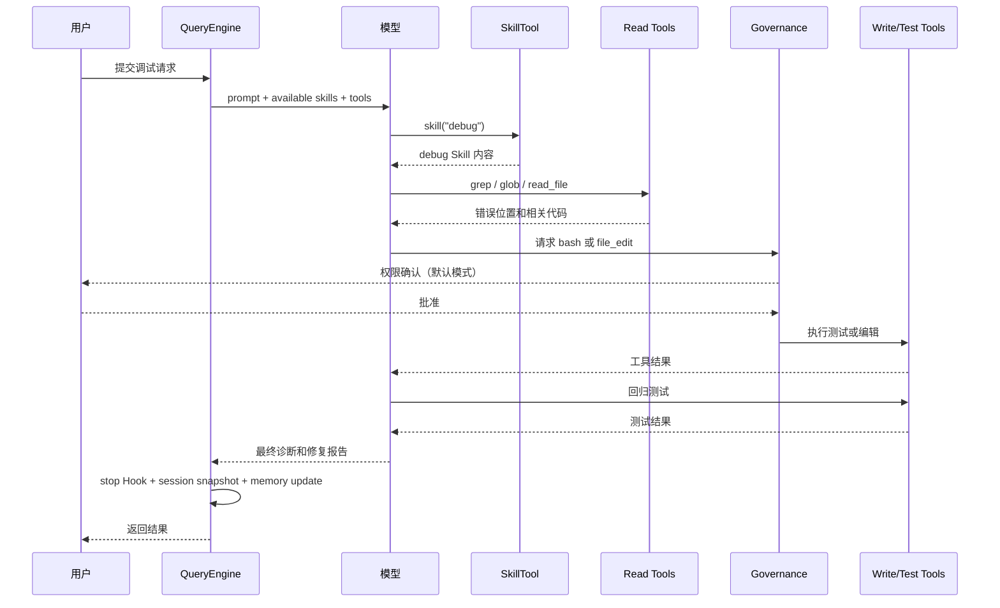

# OpenHarness 项目架构分析

OpenHarness 的核心定位不是一个简单的 CLI，而是一个可插拔的 **Agent Harness Runtime**：

> LLM 负责推理，OpenHarness 提供工具、记忆、权限、会话、插件、多智能体和交互界面。

整体可以抽象成：



## 1. 顶层目录职责

源码主要位于 src/openharness，大致可以分成以下几层：

| 目录 | 主要职责 |
|---|---|
| `api/` | Anthropic、OpenAI-compatible、Codex、Copilot 等模型客户端 |
| `engine/` | Agent 核心循环、消息模型、流式事件、Token/成本统计 |
| `tools/` | 文件、Shell、搜索、MCP、任务、团队、Web 等工具 |
| `permissions/` | 工具权限、路径规则、命令规则、敏感文件保护 |
| `hooks/` | `SESSION_START`、`PRE_TOOL_USE`、`POST_TOOL_USE`、`STOP` 等生命周期钩子 |
| `config/` | 设置、provider profile、认证、路径和运行时配置 |
| `ui/` | 运行时组装、后端宿主、React/Ink TUI 接入 |
| `commands/` | Slash commands，例如 `/model`、`/resume`、`/permissions` |
| `skills/` | 按需加载的 Markdown 技能 |
| `plugins/` | 插件发现和加载，支持 tools、skills、commands、hooks、agents、MCP |
| `memory/` 和 `services/` | 会话记忆、持久记忆、压缩、自动提取、定时任务 |
| `mcp/` | MCP Server 配置、连接和工具暴露 |
| `coordinator/` | Agent 定义、协调器上下文和团队注册 |
| `swarm/` | 子 Agent、后台任务、subprocess/in-process 后端 |
| `channels/` | 外部聊天平台消息适配和消息总线 |
| `sandbox/` | Docker 等隔离运行环境 |
| `autopilot/`、`tasks/` | 仓库自动化流水线（intake / 打分 / 执行 / 验证 / PR）、后台任务和任务生命周期，详见第 10 节 |
| `auth/` | 各 Provider 的登录、Token 刷新和凭据存储 |
| `bridge/` | `ChannelBridge` 等跨进程/跨渠道消息桥接实现 |
| `personalization/` | `ohmo` 的用户偏好、画像和个性化设置 |
| `state/` | 运行时和会话级共享状态存取 |

`pyproject.toml` 中定义了三个主要命令入口：

- `oh`
- `openharness`
- `openh`

它们都进入 `openharness.cli:app`。

`ohmo` 是另一个入口，进入 `ohmo.cli:app`。它复用 OpenHarness 的运行时，但增加了个人助理工作区、消息渠道和长期记忆。

---

## 2. 核心运行时：`RuntimeBundle`

OpenHarness 的关键设计是使用统一的运行时组装器，而不是让 CLI、TUI、后台 Agent、ohmo 各自实现一套 Agent。

核心文件是：

- ui/runtime.py
- engine/query_engine.py
- engine/query.py

`build_runtime()` 会构造一个 `RuntimeBundle`，其中包含：

```text
RuntimeBundle
├── api_client
├── mcp_manager
├── tool_registry
├── app_state
├── hook_executor
├── engine
├── commands
├── session_backend
├── plugin roots
├── skill roots
└── memory backend
```

运行时初始化流程大致是：

1. 读取默认配置、环境变量、CLI 参数和 provider profile。
2. 加载插件。
3. 创建 API Client。
4. 创建并连接 MCP Server。
5. 创建默认工具注册表。
6. 注册插件提供的工具。
7. 创建权限检查器。
8. 创建 HookExecutor。
9. 构造 system prompt。
10. 创建 `QueryEngine`。
11. 根据配置启动 Docker sandbox。
12. 返回可供 TUI、打印模式或后台任务复用的 `RuntimeBundle`。

这体现出项目的核心架构风格：

> 配置和依赖在运行时集中组装，Agent Engine 保持相对独立。

因此，同一个 Agent 核心可以被多种入口调用：

- 交互式 React TUI
- `oh -p "..."` 非交互模式
- 后台任务 worker
- 子 Agent
- `ohmo`
- 外部聊天渠道

---

## 3. Agent Loop：OpenHarness 的核心执行路径

核心循环在 engine/query.py 的 `run_query()`。

每一轮 Agent 执行过程大致如下：

```mermaid
sequenceDiagram
    participant User as 用户/外部消息
    participant Engine as QueryEngine
    participant Loop as run_query
    participant Model as Provider API
    participant Perm as PermissionChecker
    participant Tool as ToolRegistry
    participant Hook as HookExecutor

    User->>Engine: submit_message(prompt)
    Engine->>Loop: run_query(context, messages)
    Loop->>Loop: auto compact / image preprocess
    Loop->>Model: stream_message(...)
    Model-->>Loop: text delta / tool use / usage
    Loop-->>Engine: StreamEvent

    alt 模型请求工具
        Loop->>Hook: PRE_TOOL_USE
        Loop->>Perm: evaluate(...)
        Perm-->>Loop: allow / deny / confirmation
        Loop->>Tool: execute(...)
        Tool-->>Loop: ToolResult
        Loop->>Loop: append tool result
        Loop->>Model: 下一轮请求
    else 模型结束
        Loop->>Hook: STOP
        Loop-->>Engine: AssistantTurnComplete
    end

    Engine->>Engine: 保存 session / memory / usage
```

### 3.1 模型调用

模型客户端通过统一协议 `SupportsStreamingMessages` 抽象。

运行时根据当前 profile 选择不同实现：

- `AnthropicApiClient`
- `OpenAICompatibleClient`
- `CodexApiClient`
- `CopilotClient`

因此上层 Agent Loop 不需要知道具体是 Anthropic、OpenAI、Codex 还是 Copilot。

这是一个比较典型的 **Provider Adapter + Stable Runtime Interface** 设计。

### 3.2 工具调用

工具抽象位于 tools/base.py。

每个工具都继承 `BaseTool`，包含：

```python
name
description
input_model
execute(...)
is_read_only(...)
to_api_schema(...)
```

`ToolRegistry` 负责：

- 注册工具
- 按名称查找工具
- 生成传给模型的工具 JSON Schema
- 执行时根据工具名分发实现

工具输入使用 Pydantic 模型校验，这比直接处理字典更可靠。

核心工具类别包括：

- 文件读写和编辑
- Shell/Bash
- `grep` / `glob`
- Web Search / Web Fetch
- MCP Tool
- Skill Tool
- Agent/Subagent Tool
- Task/Team Tool
- 用户询问工具
- Notebook 工具
- 计划模式和工作树工具

### 3.3 并行工具调用

当模型一次返回多个 tool call 时，`run_query()` 使用 `asyncio.gather()` 并行执行。

这带来两个好处：

- 多个互不依赖的读取操作可以并行进行。
- Agent 对模型返回的批量工具调用响应更快。

同时代码使用 `return_exceptions=True`，避免一个工具失败导致其它工具的结果丢失，保证每个 `tool_use` 都有对应的 `tool_result`。

这是对 Anthropic 消息协议约束的直接适配。

### 3.4 主 Agent 的决策职责与上下文累积

默认调试流程中，OpenHarness 不把“复现 → 读取错误 → 定位 → 建立假设 → 修复 → 测试”实现成固定状态机。主 Agent（模型）负责：

- 分析当前错误和已有证据。
- 决定下一步应该搜索、读取、执行测试还是修改代码。
- 选择要调用的工具和工具参数。
- 根据工具结果修正或确认根因假设。
- 判断是否需要继续迭代、委派子 Agent 或结束任务。

`run_query()` 负责的是通用控制循环，而不是调试策略：它向模型发送当前上下文，执行模型返回的 tool call，将结果追加到消息历史，然后再次请求模型。

```text
模型分析当前上下文
    ↓
决定下一步动作并生成 tool call
    ↓
Agent Loop 执行工具
    ↓
工具结果追加到 messages
    ↓
带着更新后的 messages 再次请求模型
    ↓
模型继续分析并决定下一步
```

一次用户回合中的消息历史是结构化的 `ConversationMessage` 列表，而不是简单拼接成一段字符串：

```text
user: 用户调试请求
assistant: tool_use(grep)
user: tool_result(grep 输出)
assistant: tool_use(read_file)
user: tool_result(文件内容)
assistant: tool_use(bash)
user: tool_result(测试输出)
assistant: tool_use(file_edit)
user: tool_result(编辑结果)
```

因此，后续模型请求通常会看到前面同一回合的用户消息、assistant tool call 和工具结果。`skill("debug")` 的正文也通常以 `skill` 工具的 tool result 进入消息历史，而不是直接修改 system prompt。

跨用户回合时，`QueryEngine` 会继续保留会话消息，因此用户可以在下一条消息中引用“刚才的修复”或“上一次测试结果”。但消息不会无限原样增长：上下文过长时，OpenHarness 会执行 microcompact、工具输出裁剪、artifact 外置或 LLM 摘要压缩，并通过 `pre_compact` / `post_compact` Hook 管理压缩前后流程。

主 Agent 不是工具执行器本身。它决定“调用 `bash` 或 `file_edit`”，而 Runtime 负责参数校验、权限判断、Hook、实际执行和错误封装；执行结果再返回主 Agent。

---

## 4. `QueryEngine`：会话级状态所有者

engine/query_engine.py 中的 `QueryEngine` 不负责底层 Provider 选择，而是负责一个会话的长期状态：

```text
QueryEngine
├── conversation messages
├── current model
├── system prompt
├── tool registry
├── permission checker
├── HookExecutor
├── usage / cost tracker
├── tool metadata
└── memory lifecycle
```

它主要做几件事：

1. 保存会话消息。
2. 接收新的用户输入。
3. 创建 `QueryContext`。
4. 调用 `run_query()`。
5. 累计 Token 和成本。
6. 持久化会话。
7. 更新 session memory。
8. 执行 durable memory 提取。
9. 安排后台自动记忆整理。

因此可以区分：

- `run_query()`：一次具体的 Agent Loop。
- `QueryEngine`：一个持续存在的会话容器。

这个分层比较合理，避免了把“循环算法”和“会话生命周期”揉在一个函数里。

---

## 5. 权限与安全架构

权限控制主要由 permissions/checker.py 实现。

权限判断顺序大致为：

1. 内置敏感路径保护。
2. 显式 deny tool。
3. 显式 allow tool。
4. 路径级规则。
5. 命令 deny pattern。
6. `full_auto` 模式。
7. 只读工具自动允许。
8. `plan` 模式阻止修改类工具。
9. 默认模式要求用户确认。

内置敏感路径包括：

- `.ssh`
- `.aws`
- `.config/gcloud`
- `.azure`
- `.gnupg`
- `.docker/config.json`
- `.kube/config`
- OpenHarness 自身凭据文件，具体为 `.openharness/credentials.json` 和 `.openharness/copilot_auth.json`

这一点很重要：即使用户配置了自动模式，敏感凭据路径仍然有额外保护。

权限决策不是直接写死在每个工具内部，而是由统一的 `PermissionChecker` 控制。这使得：

- 工具实现更简单。
- 权限模式可以运行时切换。
- CLI、TUI 和后台模式能够共享相同策略。

不过，权限安全最终仍取决于工具是否正确声明读写属性，以及工具是否提供完整的路径和命令信息。

---

## 6. Hooks：非侵入式治理层

Hooks 是独立于 Agent Loop 的治理机制。当前 `HookEvent` 枚举中共有 **10 个事件**，事件定义位于 `src/openharness/hooks/events.py`，由 `HookExecutor` 统一调度。

### 6.1 当前所有 Hook 事件

| 事件 | 触发时机 | 主要用途 | 是否处于关键执行路径 |
|---|---|---|---|
| `session_start` | Runtime 启动完成后，由 `start_runtime()` 触发 | 初始化、环境检查、会话审计 | 是，启动钩子执行失败可被观察 |
| `session_end` | Runtime 关闭时，由 `close_runtime()` 触发 | 清理、归档、会话统计和审计 | 是，关闭阶段执行 |
| `user_prompt_submit` | `QueryEngine.submit_message()` 接收并追加用户消息后 | 记录用户请求、预处理、策略检查 | 是，每次用户提交触发 |
| `pre_tool_use` | Agent 准备执行模型请求的工具之前 | 工具审计、参数校验、策略阻断 | 是，可以阻止工具执行 |
| `post_tool_use` | 工具执行完成并生成 `ToolResult` 后 | 记录结果、审计输出、后处理 | 是，工具执行成功或失败后均可触发 |
| `notification` | 默认权限模式下，即将向用户显示工具权限确认时 | 通知外部系统、记录待确认操作 | 否，通知失败不会替代权限询问 |
| `stop` | 模型返回的最终消息不再包含工具调用时 | 记录 Agent 回合结束、触发后处理 | 是，正常停止路径触发 |
| `pre_compact` | 对话压缩即将开始、准备压缩上下文时 | 检查或阻止压缩、保存压缩前信息 | 是，可以阻止本次压缩 |
| `post_compact` | 压缩摘要和新的消息列表生成后 | 记录压缩结果、处理摘要附件和元数据 | 是，压缩完成后触发 |
| `subagent_stop` | 被 `agent` 工具创建的后台子 Agent 结束时 | 记录子 Agent 状态、通知协调器和外部系统 | 取决于子 Agent 任务生命周期 |

事件值是小写字符串，例如 `PRE_TOOL_USE` 对应配置事件名 `pre_tool_use`，而不是枚举名本身。

### 6.2 关键事件的执行路径

工具调用相关 Hook 的顺序如下：

```text
模型请求工具
    ↓
PRE_TOOL_USE Hook
    ↓
Hook blocked ? ── 是 ──> 返回错误 ToolResult，不执行工具
    ↓ 否
PermissionChecker
    ↓
需要确认 ? ── 是 ──> NOTIFICATION Hook → 用户确认
    ↓ 允许
工具执行
    ↓
POST_TOOL_USE Hook
```

需要注意：`pre_tool_use` 先于权限检查执行，因此它可以在权限系统之前拒绝一个工具调用；`notification` 只在默认权限模式触发用户确认流程，并不是所有权限拒绝都会触发。

对话压缩相关 Hook 的顺序如下：

```text
检测到需要压缩
    ↓
PRE_COMPACT Hook
    ↓
Hook blocked ? ── 是 ──> 取消本次压缩
    ↓ 否
微压缩 / LLM 摘要压缩
    ↓
POST_COMPACT Hook
```

### 6.3 Hook 实现类型

OpenHarness 当前支持四种 Hook 定义：

| 类型 | 执行方式 | 默认失败语义 |
|---|---|---|
| `command` | 在当前工作目录启动 Shell 子进程 | 默认记录失败，不阻断 |
| `prompt` | 使用当前模型对 Hook 条件进行轻量 JSON 判定 | 默认阻断 |
| `http` | 向配置的 HTTP endpoint POST 事件和 payload | 默认记录失败，不阻断 |
| `agent` | 使用模型进行更深入的 Hook 条件验证 | 默认阻断 |

其中 `prompt` 和 `agent` Hook 要求模型返回类似下面的 JSON：

```json
{"ok": true}
```

或者：

```json
{"ok": false, "reason": "拒绝原因"}
```

每种 Hook 都支持以下通用配置：

- `matcher`：使用 glob 风格匹配事件 payload 中的 `tool_name`、`prompt` 或 `event`。
- `priority`：数值越大越先执行；相同优先级保持注册顺序。
- `timeout_seconds`：限制命令、HTTP 或模型判定的最长执行时间。
- `block_on_failure`：Hook 失败时是否将聚合结果标记为 blocked。
- `$ARGUMENTS`：在 command/prompt/agent 模板中注入当前事件 payload；Shell command 会进行 Shell 转义。

### 6.4 Hook 来源与治理边界

Hook 可以来自两个配置来源：

1. 当前 settings 中的 Hook 配置。
2. 已启用插件提供的 Hook 配置。

`load_hook_registry()` 会把两者合并到 `HookRegistry`。未识别的事件名会被忽略，因此插件只能注册框架 `HookEvent` 枚举中已经支持的事件。

Hooks 的价值在于，可以将审计、策略、自动化和外部集成从核心循环中分离出来。插件也可以提供 Hooks，因此扩展者不必修改核心代码；但 `command`、`prompt`、`agent` Hook 都可能影响 Agent 行为，应当与插件一样视为高信任配置。

---

## 7. 插件、Skills 和 MCP 的扩展模型

OpenHarness 的扩展体系实际上有三个层次。

### 7.1 Skills

Skills 主要是 Markdown 文件，提供领域知识或行为规范。

它们适合：

- 编程规范
- 特定领域流程
- 项目操作说明
- 代码审查流程
- 数据分析方法

Skills 不一定需要新增 Python 代码，因此扩展成本最低。

#### 7.1.1 框架内置 Skills

当前 OpenHarness 源码随包提供 `src/openharness/skills/bundled/content/` 下的 8 个内置 Skill：

| Skill | 主要用途 | 默认调用方式 |
|---|---|---|
| `commit` | 整理变更、生成提交信息、只暂存相关文件并完成 Git commit | 用户请求提交代码、创建 PR 或准备评审时使用 |
| `debug` | 按复现、读取错误、定位、假设、验证、修复、测试的流程排查 Bug | 用户报告 Bug、错误或异常行为时使用 |
| `diagnose` | 根据运行产物、执行轨迹和失败签名诊断 Agent Run 失败或回归 | 用户询问 Agent 运行失败、结果异常或前后运行差异时使用 |
| `plan` | 在编码前分析需求、约束、现有实现、修改步骤和验证方式 | 用户要求规划、设计或架构方案而暂不实现时使用 |
| `review` | 以代码审查视角检查 Bug、安全、性能、测试覆盖和质量问题 | 用户要求 Review 代码、PR 或 Diff 时使用 |
| `simplify` | 在保持行为不变的前提下减少复杂度、重复和不必要抽象 | 用户要求简化、清理或重构代码时使用 |
| `skill-creator` | 创建、改进、验证 Skill，处理 Skill 触发词、元数据、加载和测试 | 用户要求创建或修改 Skill，或排查 Skill 加载问题时使用 |
| `test` | 根据项目既有测试模式编写、运行和补充测试覆盖 | 用户要求写测试、验证行为或改进测试覆盖时使用 |

这些 bundled Skill 是普通 Markdown 文件，由 `get_bundled_skills()` 扫描并转换为 `SkillDefinition`，其 `source` 标记为 `bundled`。它们不是硬编码在 Agent Loop 中的特殊分支，仍然通过统一的 Skill Registry 和 `skill` 工具加载。

#### 7.1.2 当前 OpenHarness 仓库中的项目 Skills

除了框架内置 Skill，当前仓库还包含两个项目级 `.claude/skills` Skill：

| Skill | 主要用途 | 来源 |
|---|---|---|
| `pr-merge` | 以贡献者归属为优先处理 PR 合并、冲突解决、选择性合并和合并后验证 | `OpenHarness/.claude/skills/pr-merge/SKILL.md` |
| `harness-eval` | 使用真实模型和真实工具链对陌生代码库进行端到端 Harness 验证 | `OpenHarness/.claude/skills/harness-eval/SKILL.md` |

这两个 Skill 属于当前项目配置，不属于 OpenHarness Python 包内置 Skill。它们是否可见取决于当前工作目录、项目 Skill 配置和 `allow_project_skills` 设置。

#### 7.1.3 Skill 的发现和覆盖顺序

`load_skill_registry()` 会按以下来源加载 Skill：

1. bundled Skill：`src/openharness/skills/bundled/content/*.md`。
2. 用户级 OpenHarness 目录：`~/.openharness/skills/`。
3. 用户级兼容目录：`~/.claude/skills/` 和 `~/.agents/skills/`。
4. 运行时传入的额外 Skill 目录。
5. 从当前目录向 Git root 搜索到的项目 Skill 目录，默认包括：
   - `.openharness/skills/`
   - `.agents/skills/`
   - `.claude/skills/`
6. 已启用插件声明的 Skill。

Skill 采用 `<root>/<skill-name>/SKILL.md` 目录布局。Registry 以 Skill 的 `name`、目录名 `command_name`、显示名和别名建立索引；后注册的同名 key 会覆盖先注册的条目，因此更具体的项目 Skill 或插件 Skill 可以覆盖较宽范围的定义。项目目录的搜索顺序从较不具体的位置到较具体的位置，保证子目录或当前项目能够覆盖上层配置。

#### 7.1.4 Skill 元数据和调用控制

每个 Skill 可以在 Markdown 文件开头使用 YAML frontmatter 声明：

```yaml
---
name: example
description: Describe when this skill should be used.
user-invocable: true
disable-model-invocation: false
model: optional-model
argument-hint: optional argument hint
---
```

加载后会形成 `SkillDefinition`，核心字段包括：

- `name`：Skill 的逻辑名称。
- `description`：用于匹配和展示的用途说明。
- `content`：完整 Markdown 指令正文。
- `source`：`bundled`、`user`、`project` 或插件来源。
- `command_name`：目录名对应的 slash command 名称。
- `user_invocable`：是否允许用户主动调用。
- `disable_model_invocation`：是否禁止模型自动选择该 Skill。
- `model`：可选的 Skill 专用模型。
- `argument_hint`：调用参数提示。

因此 Skill 有两种主要入口：

```text
用户输入 slash command
    ↓
Skill Registry 按 command_name 查找
    ↓
加载 Skill 内容并执行

普通用户 Prompt
    ↓
Skill 匹配 / 相关性判断
    ↓
skill 工具按需加载匹配 Skill
    ↓
将 Skill 内容注入当前 Agent 上下文
```

与插件类似，Skill 文件本身属于高信任指令来源：它可以改变 Agent 的行为约束，但通常不直接提供 Python 执行能力。真正的文件、Shell、网络或子 Agent 操作仍由工具层和权限层控制。

### 7.2 Plugins

插件加载器位于 plugins/loader.py。

#### 7.2.1 当前实际已有的 Plugin

按当前 OpenHarness 工作树核对，仓库中没有发现 `plugin.json` 或 `.claude-plugin/plugin.json` manifest，`src/openharness/plugins/bundled/` 也没有内置插件实现。因此当前实际可发现的插件数量是：

> **0 个已安装 Plugin**

这与前面列出的 bundled Skills 不同：OpenHarness 当前随包提供 Skill 内容，但没有随包提供一个可直接加载的 bundled Plugin。测试和脚本中可能会临时创建插件目录来验证加载流程，但这些不属于仓库中持久存在的 Plugin 实例。

#### 7.2.2 Plugin 支持的组成

插件可以提供：

- `skills`
- slash `commands`
- `tools`
- `agents`
- `hooks`
- MCP Server 配置

一个已加载插件在运行时表示为 `LoadedPlugin`，包含以下字段：

```text
LoadedPlugin
├── manifest
├── path
├── enabled
├── skills
├── commands
├── agents
├── tools
├── hooks
└── mcp_servers
```

其 manifest 使用 `PluginManifest` 描述，关键字段包括：

- `name`：插件唯一名称。
- `version`：插件版本，默认值为 `0.0.0`。
- `description`：插件说明。
- `enabled_by_default`：是否默认启用。
- `skills_dir`：Skill 目录，默认是 `skills`。
- `tools_dir`：Python 工具目录，默认是 `tools`。
- `hooks_file`：Hook 配置文件，默认是 `hooks.json`。
- `mcp_file`：MCP 配置文件，默认是 `mcp.json`。
- `commands`、`agents`、`skills`、`hooks`：可选的扩展声明字段。

插件中的 Python Tool 只有在插件启用时才加载；Skill、Command、Agent、Hook 和 MCP 配置则由各自的加载器解析后并入当前 Runtime。

插件来源包括：

- 用户级插件目录
- 项目级 `.openharness/plugins`
- `ohmo` 注入的额外插件目录
- 运行时传入的额外 root

实际默认搜索路径为：

```text
用户插件：~/.openharness/plugins/<plugin-name>/plugin.json
项目插件：<cwd>/.openharness/plugins/<plugin-name>/plugin.json
兼容 manifest：<plugin-name>/.claude-plugin/plugin.json
额外插件：由 extra_plugin_roots 传入的目录
```

用户级插件默认参与加载；项目级插件默认受 `allow_project_plugins` 控制，未明确信任项目插件时不会加载。插件启用状态还可以由 `settings.enabled_plugins` 中的插件名覆盖 `enabled_by_default`。

插件加载流程是：

```text
发现 plugin.json
    ↓
解析 manifest
    ↓
读取 skills / commands / agents / hooks / mcp
    ↓
若启用则加载 Python tools
    ↓
合并到 RuntimeBundle
```

项目级插件默认可能被禁用，这是一种比较重要的信任边界设计，因为项目目录中的插件本质上可以执行代码。安装器提供 `install_plugin_from_path()` 和 `uninstall_plugin()`，但当前仓库没有已安装的插件可供列举。

### 7.3 MCP

MCP 由 `McpClientManager` 管理。

运行时会：

1. 从 settings 和插件读取 MCP Server 配置。
2. 连接所有 MCP Server。
3. 将 MCP Tools 转化为 OpenHarness 工具。
4. 将 MCP Resources 暴露给 Agent。
5. 处理连接失败、断线和关闭。

因此 OpenHarness 的工具生态并不局限于内置 Python 工具，也可以通过 MCP 接入外部工具服务器。

---

## 8. 多智能体和 Swarm 架构

多 Agent 入口主要是 tools/agent_tool.py。

Agent Tool 接收：

```text
description
prompt
subagent_type
model
command
team
mode
```

支持的模式包括：

- `local_agent`
- `remote_agent`
- `in_process_teammate`

目前源码中即使请求 `in_process_teammate`，也倾向通过 subprocess backend 让任务进入统一的后台任务管理体系。这样做的好处是：

- 后台任务可轮询。
- 有统一的 task ID。
- 子 Agent 生命周期更容易管理。
- 跨平台行为更一致。

大致关系是：

```text
AgentTool
    ↓
Swarm Backend Registry
    ↓
Subprocess Backend
    ↓
BackgroundTaskManager
    ↓
Task / Team Registry
    ↓
Subagent Hook
```

这说明项目的多 Agent 设计不是简单递归调用，而是包含：

- Agent 定义
- 任务注册
- 团队关系
- 子进程生命周期
- 结果查询
- 完成事件
- Hook 通知

它更接近一个轻量的本地 Agent 调度系统。

### 8.1 主 Agent 如何发现和选择子 Agent

`agent` 工具的输入包含 `subagent_type`。主 Agent 先决定这个字符串，`AgentTool` 再调用 `get_agent_definition()` 查找对应定义；因此 Agent Definition 是按名称动态解析的，而不是由 `AgentTool` 自动替主 Agent 规划任务。

当前内置 Agent Definition 包括：

```text
general-purpose
statusline-setup
claude-code-guide
Explore
Plan
worker
verification
```

普通模式的 system prompt 主要给出 `worker` 的默认委派示例，并建议在任务明确要求子 Agent、后台工作或并行调查时使用 `agent` 工具。它不会自动把所有内置和自定义 Agent 的完整清单都注入模型上下文。

用户自定义 Agent 默认从以下目录加载：

```text
~/.openharness/agents/*.md
```

启用的 Plugin 也可以提供 Agent。定义加载的覆盖顺序为：

```text
内置 Agent
    ↓
用户 Agent
    ↓
启用的 Plugin Agent
```

同名定义由后者覆盖前者。主 Agent 要稳定使用自定义 Agent，通常需要在用户 prompt、system prompt 或 Skill 中明确写出 Agent 名称和使用条件；否则仅仅把文件放进 `~/.openharness/agents/` 并不保证模型会主动发现并选择它。

主 Agent 也可以在 `prompt` 中临时描述一个角色，但未知的 `subagent_type` 不会自动生成持久的 Agent Definition：找不到预定义项时，任务仍可能创建，但不会获得该定义专属的 system prompt、model 或 permissions。

### 8.2 子 Agent 的上下文和文件系统边界

子 Agent 是独立的后台 Agent 执行单元，通常拥有自己的：

- 进程。
- `RuntimeBundle` / `QueryEngine`。
- 消息历史和 Agent Loop。
- API 请求和工具调用上下文。
- task ID、状态和输出记录。

主 Agent 不会自动看到子 Agent 的完整中间消息历史。子 Agent 的结论需要通过 `task_get`、`task_output` 或消息机制返回；返回内容进入主 Agent 的消息历史后，主 Agent 才能据此继续决策。

当前 `AgentTool` 默认把主 Agent 的 `context.cwd` 传给 `TeammateSpawnConfig`，再由 subprocess backend 作为子进程的工作目录。因此普通 `agent(...)` 调用默认是：

```text
主 Agent cwd: /project
子 Agent A cwd: /project
子 Agent B cwd: /project
```

这表示默认共享文件系统目录，但不共享消息历史或推理上下文。只读子 Agent 可以安全地共享 cwd；多个可写子 Agent 并行修改同一文件时则存在覆盖、竞态和未提交修改相互干扰的风险。

OpenHarness 提供 Git worktree 基础设施（`WorktreeManager`、`worktree_path` 和 `enter_worktree` 工具），Autopilot 等专门流程可以显式创建 worktree 并把它作为任务 cwd：

```text
主 Agent cwd: /project
子 Agent cwd: ~/.openharness/worktrees/bug-fix
```

但当前普通 `AgentTool` 调用不会自动为每个子 Agent 创建 worktree，也没有把 Agent Definition 中的 `isolation: worktree` 自动转换为 worktree 创建流程。因此要实现修改隔离，需要由上层 orchestrator、Autopilot 或显式 worktree 流程分配独立工作目录。

需要指出的是，`isolation` 字段（取值为 `worktree` 或 `remote`，定义在 `coordinator/agent_definitions.py` 的 `ISOLATION_MODES` 中，`plugins/loader.py` 也会解析同名 frontmatter 字段）目前只是被解析出来存进 `AgentDefinition`，`tools/agent_tool.py` 全文没有任何地方读取或消费这个字段。也就是说，即使某个 Agent Definition 声明了 `isolation: worktree`，`AgentTool` 调用它时也不会自动创建 worktree ——这个字段当前是"已解析但未被使用"的死配置。全仓库唯一真正调用 `WorktreeManager.create_worktree()` 的地方是 `autopilot/service.py`（见第 10 节），不在通用 Agent 调度路径上。

推荐的调试分工是：

```text
主 Agent
    ├── Explore / root-cause-analyst：共享 cwd，只读分析
    ├── worker / bug-fixer：在显式 worktree 中修改代码
    └── verification：在修复 worktree 中只读验证
```

---

## 9. `ohmo` 是什么关系？

`ohmo` 不是完全独立的 Agent 实现，而是 OpenHarness Runtime 的一个应用层封装。

核心文件是 ohmo/runtime.py。

它复用：

- `build_runtime`
- `run_backend_host`
- `handle_line`
- `QueryEngine`
- ToolRegistry
- MCP
- Hooks
- Plugin loader
- React TUI

同时替换或增加：

- 独立的 `~/.ohmo` workspace
- Ohmo session backend
- Ohmo memory backend
- Ohmo system prompt
- Ohmo 专属 skills/plugins 目录
- 外部聊天通道
- 长期个人记忆

因此可以理解为：

```text
OpenHarness
    └── 通用 Agent Runtime

ohmo
    └── 基于该 Runtime 的个人助理产品
```

这是一种比较健康的复用关系：产品层定制行为，核心层保持通用。

---

## 10. Autopilot：仓库自动化流水线

Autopilot 位于 autopilot/service.py 和 autopilot/types.py，是构建在通用 Agent Runtime 之上的一个独立应用层，定位是"项目级、无人值守的自动开发流水线"，与 `ohmo`（个人助理产品）是并列关系，但服务目标不同：`ohmo` 面向对话式个人助理，Autopilot 面向"自动发现任务 → 自动修复/实现 → 自动验证 → 自动开 PR/合并"的仓库自维护场景。

### 10.1 任务来源与打分

Autopilot 把不同来源的工作项统一收进一个队列（`RepoTaskCard`），来源包括：

```text
ohmo_request        # ohmo 个人助理主动提出的需求
manual_idea         # 人工录入的想法
github_issue
github_pr
claude_code_candidate
```

每个来源有基础分（`_SOURCE_BASE_SCORES`），再叠加 bug/紧急关键词加权（`_BUG_HINTS`、`_URGENT_HINTS`）得到最终排队优先级；`_DEFAULT_AUTOPILOT_POLICY` 中的 `intake` 配置控制去重策略（`dedupe_strategy: source_ref_then_fingerprint`）和单次可见候选数上限。

### 10.2 任务状态机

`RepoTaskStatus` 定义了任务的完整生命周期：

```text
queued → accepted → preparing → running → verifying
    → pr_open → waiting_ci → repairing → completed → merged
（或在任意阶段进入 failed / rejected / superseded）
```

`decision.default_human_gate` 默认为 `True`，即接受任务前默认需要人工确认；`decision.prefer_small_safe_steps` 倾向于把任务拆成更小、更安全的步骤。

### 10.3 执行阶段的 worktree 隔离

`execution.use_worktree` 默认为 `True`：进入 `preparing`/`running` 阶段时，Autopilot 会调用 `WorktreeManager.create_worktree()`（swarm/worktree.py）为该任务在 `base_branch`（默认 `main`）上创建一个独立的 git worktree，任务的执行 cwd 指向这个 worktree，而不是主仓库目录。

这正是全仓库中唯一真正把 `isolation`/worktree 机制落地为自动创建行为的地方——如第 8.2 节所述，普通 `agent()` 子 Agent 调用并不会自动获得独立 worktree，只有 Autopilot 的任务执行才会。

任务结束（完成、合并、失败或被取代）后，worktree 会通过 `git worktree remove --force` 清理。

### 10.4 验证与 PR/CI 流程

任务执行后进入 `verifying` 阶段，运行一组验证命令，结果记录为 `RepoVerificationStep`（`command`、`returncode`、`status: success|failed|skipped|error`、`stdout`、`stderr`）。验证通过后：

1. 按 `github.pr_branch_prefix`（默认 `autopilot/`）创建分支并开 PR。
2. 按 `github.ci_poll_interval_seconds` / `ci_timeout_seconds` 轮询 CI 状态（还有 `no_checks_grace_seconds`、`checks_settle_seconds` 处理"暂无 CI 检查"和"检查刚创建还未稳定"的边界情况）。
3. 若验证或 CI 失败，进入 `repairing` 状态重试，最多 `execution.max_attempts`（默认 3）次。
4. 达成合并条件后，按 `github.auto_merge.mode`（默认 `label_gated`，即需要特定标签才自动合并）决定是否自动合并。

### 10.5 产物与可观测性

每次运行会在 `<project>/.openharness/autopilot/runs/` 下落盘 run report、verification report、任务 journal（`RepoJournalEntry`：时间戳、事件类型、摘要、关联 task_id）等产物，并把当前处理的仓库上下文、注册表（`RepoAutopilotRegistry`）保存在项目级路径（`config/paths.py` 中的 `get_project_autopilot_*` 系列函数）。这部分内容也在第 14.6 节（原第 13.6 节）中提及。

需要注意：`diagnose` Skill 中提到的 `manifest.json`、`execution_trace.jsonl`、`verification_report.json`、`failure_signature.json` 属于特定评估/运行产物约定，不是 Autopilot 或普通 Agent Loop 默认必然生成的文件。

---

## 11. 外部聊天渠道架构

聊天渠道通过 channels/bus/events.py 中的消息对象解耦：

```python
InboundMessage
OutboundMessage
```

消息链路为：



channels/adapter.py 中的 `ChannelBridge` 主要负责：

1. 从 inbound queue 取消息。
2. 调用 `QueryEngine.submit_message()`。
3. 收集 `AssistantTextDelta`。
4. 生成 `OutboundMessage`。
5. 放回 outbound queue。

频道适配器只需要关心平台协议，不需要理解 Agent Loop。

会话键会根据以下信息隔离上下文：

- channel
- chat ID
- sender ID
- thread ID
- 私聊/群聊类型

这避免了不同群成员或不同线程共享错误的 Agent 上下文。

---

## 12. UI 架构

前端位于 frontend/terminal。

Python 侧主要承担：

- Runtime 构造
- Agent Loop
- 工具执行
- 事件生成
- 后端进程
- 会话保存

React/Ink 侧主要承担：

- 终端渲染
- 输入处理
- Slash command 交互
- 权限确认 UI
- 流式事件展示
- TUI 状态管理

典型流程是：

```text
React/Ink TUI
    ↕ stdin/stdout 或 backend protocol
Python Backend Host
    ↓
RuntimeBundle
    ↓
QueryEngine
```

这是一种“Python 后端 + Node 终端前端”的架构。Python 负责 Agent 能力，React/Ink 负责交互体验。

优点是 UI 和 Agent Runtime 可以分别演进；代价是需要维护：

- Python 与 TypeScript 的协议
- 子进程启动
- Windows 终端行为
- Node 依赖安装
- 流式事件序列化

---

## 13. 关键数据流

### 13.1 一次普通请求

```text
CLI/TUI/Channel
    ↓
handle_line()
    ↓
QueryEngine.submit_message()
    ↓
run_query()
    ↓
Provider API
    ↓
AssistantTextDelta / ToolUse
    ↓
ToolRegistry
    ↓
PermissionChecker + Hooks
    ↓
ToolResult
    ↓
继续请求模型
    ↓
AssistantTurnComplete
    ↓
SessionBackend.save_snapshot()
```

### 13.2 一次插件工具调用

```text
plugin.json
    ↓
load_plugins()
    ↓
LoadedPlugin.tools
    ↓
ToolRegistry.register()
    ↓
tool_registry.to_api_schema()
    ↓
模型选择插件工具
    ↓
PluginTool.execute()
```

### 13.3 一次子 Agent 调用

```text
模型调用 agent 工具
    ↓
AgentTool
    ↓
Swarm Backend Registry
    ↓
Subprocess Backend
    ↓
BackgroundTaskManager
    ↓
task_id
    ↓
task_get / task_output / task_stop
```

### 13.4 用户要求调试代码时的典型运行

假设用户在项目目录中输入：

```text
请帮我调试登录接口。最近 POST /login 总是返回 500，请定位根因，修复代码，并运行相关测试验证。
```

在默认权限模式下，OpenHarness 很可能按照下面的路径运行。这里的“很可能”表示工具选择由模型决定；Runtime 初始化、权限检查、Hook 和会话保存则是框架确定的控制流程。

#### 阶段 1：启动并组装 Runtime

```text
CLI / TUI 接收用户输入
    ↓
build_runtime()
    ↓
加载 settings、provider profile 和当前 cwd
    ↓
加载 bundled / user / project / plugin skills
    ↓
创建 API Client、MCP Manager、ToolRegistry、PermissionChecker、HookExecutor
    ↓
构造 system prompt
    ↓
创建 QueryEngine
```

system prompt 会加入 `# Available Skills`，其中通常会列出 `debug`、`test`、`review` 等可用 Skill。此时模型知道可以通过只读的 `skill` 工具读取 `debug` 的详细指令，但 Skill 正文尚未必然进入对话上下文。

#### 阶段 2：模型读取调试流程并探索代码

模型可能先调用：

```text
skill(name="debug")
```

`SkillTool` 会重新加载当前目录下的 Skill Registry，找到 bundled 的 `debug`，返回其 Markdown 内容。由于 `skill` 工具是只读工具，默认权限模式下可以直接执行。

读取 `debug` Skill 后，模型通常会按照“复现 → 读取错误 → 定位 → 建立假设 → 验证 → 修复 → 测试”的顺序继续工作，并可能调用：

```text
grep(query="/login|500|Internal Server Error", path=".")
glob(pattern="**/*test*.py")
read_file(file_path="src/.../auth.py")
read_file(file_path="tests/.../test_auth.py")
```

这些工具大多是只读工具，`PermissionChecker` 通常直接允许。每个工具调用前仍可能触发 `pre_tool_use` Hook，执行结果后触发 `post_tool_use` Hook。

#### 阶段 3：复现并验证假设

如果需要执行测试或复现命令，模型可能调用：

```text
bash(command="pytest tests/test_auth.py -q")
```

在默认权限模式下，`bash` 通常被视为可能改变环境的工具，因此执行流程可能是：

```text
bash tool call
    ↓
PRE_TOOL_USE Hook
    ↓
PermissionChecker.evaluate(...)
    ↓
需要确认
    ↓
NOTIFICATION Hook(notification_type="permission_prompt")
    ↓
TUI 显示权限确认
    ↓
用户批准
    ↓
bash 执行测试
    ↓
POST_TOOL_USE Hook
    ↓
测试输出返回给模型
```

如果当前是 `plan` 模式，修改代码和执行变更类命令可能会被阻止；如果是 `full_auto` 模式，则通常不会等待用户确认，但内置敏感路径保护仍然生效。

#### 阶段 4：修改代码

当模型确认根因后，例如发现登录查询对不存在用户直接访问了空对象属性，它可能调用：

```text
file_edit(file_path="src/.../auth.py", old_string="...", new_string="...")
```

这里的实际控制顺序仍然是：

1. Pydantic 校验工具参数。
2. `pre_tool_use` Hook 检查工具和参数。
3. `PermissionChecker` 检查路径和工具是否允许修改。
4. 默认模式下请求用户确认，或在 `full_auto` 模式下直接执行。
5. 执行编辑并返回结果。
6. 触发 `post_tool_use` Hook。

如果编辑被拒绝，工具结果会以错误形式返回给模型。模型可能改为提出补丁、请求用户切换权限，或者继续进行只读分析，而不是绕过权限系统。

#### 阶段 5：运行回归测试并结束回合

修复后模型通常会再次调用 `bash` 运行相关测试，必要时还会调用更窄的单元测试和完整测试集：

```text
pytest tests/test_auth.py -q
pytest tests/ -q
```

当模型返回不再包含工具调用的最终消息时，`run_query()`：

1. 追加最终 assistant message。
2. 发出 `AssistantTurnComplete` 事件。
3. 触发 `stop` Hook。
4. `QueryEngine` 累计 usage/cost。
5. 更新 session memory 和 durable memory（如果配置启用）。
6. 由 `SessionBackend` 保存会话快照。

最终回复可能类似：

```text
已定位并修复登录接口的 500 错误：用户不存在时的空对象访问导致异常。
新增了对应的回归测试，并通过了 tests/test_auth.py -q。
```

完整数据流可以概括为：



如果用户改为输入：

```text
/debug 请调试 POST /login 返回 500 的问题
```

流程会略有不同：`handle_line()` 先通过 `lookup_skill_slash_command()` 找到 `debug`，然后将 `debug` Skill 正文和用户参数拼成新的 prompt，再交给 `QueryEngine.submit_message()`。之后的工具调用、权限、Hook、测试和会话保存流程与普通调试请求相同。

---

## 14. 追踪与可观测性

OpenHarness 当前没有统一的 OpenTelemetry、Jaeger 或单一 `execution_trace.jsonl` 式端到端 Trace 系统，而是由多种机制共同提供可观测性。不同机制记录的粒度不同：有的实时暴露事件，有的持久化会话，有的只统计 Token 或输出诊断日志。

### 14.1 实时 StreamEvent

`run_query()` 通过 `StreamEvent` 向 TUI、打印模式、JSON 输出和 Backend Host 暴露运行过程。主要事件包括：

```text
AssistantTextDelta
AssistantTurnComplete
ToolExecutionStarted
ToolExecutionCompleted
ErrorEvent
StatusEvent
CompactProgressEvent
```

其中：

- `AssistantTextDelta`：模型流式返回的文本增量。
- `AssistantTurnComplete`：一个模型回合完成，以及该回合的 `UsageSnapshot`。
- `ToolExecutionStarted`：工具名称和工具输入参数。
- `ToolExecutionCompleted`：工具输出、错误标记和结果 metadata。
- `ErrorEvent`：API、工具或运行时错误。
- `StatusEvent`：重试、Token 限制等状态信息。
- `CompactProgressEvent`：上下文压缩阶段、触发原因和检查点。

非交互模式使用 `--output-format stream-json` 时，会把这些事件转换为 JSON Lines，例如：

```json
{"type":"tool_started","tool_name":"grep","tool_input":{"query":"/login","path":"."}}
{"type":"tool_completed","tool_name":"grep","output":"src/auth/routes.py:42 ...","is_error":false}
{"type":"assistant_delta","text":"我找到了登录接口。"}
```

这意味着 OpenHarness 可以实时暴露模型文本、工具调用、工具输入和工具结果，但实时事件本身默认不等于磁盘上的完整 Trace 文件。

### 14.2 Session snapshot 和 transcript

默认 Session Backend 位于 `services/session_backend.py`，实际持久化由 `services/session_storage.py` 完成。会话数据通常保存在：

```text
~/.openharness/data/sessions/<project-name>-<path-hash>/
```

Snapshot JSON 会保存：

```text
session_id
cwd
model
system_prompt
messages
usage
tool_metadata
created_at
summary
message_count
```

`messages` 是结构化的 `ConversationMessage` 列表，通常可以重建：

```text
user message
assistant message
assistant tool_use
tool_result
assistant message
...
```

因此它能够记录或恢复主 Agent 的主要上下文，包括用户输入、模型文本、模型请求的工具、工具参数、工具结果和错误结果。`skill` 工具返回的 Skill 内容也通常会作为工具结果进入消息历史。

Session snapshot 不是 Provider 原始请求日志。它不保证保存：

- 发给 Provider 的完整 HTTP JSON 和 headers。
- 每次请求使用的完整 tools schema 快照。
- Provider 原始响应中的所有专有字段。
- 每次重试的底层网络请求。
- API 首 Token 延迟和完整请求耗时。

此外，过大的工具输出可能被裁剪、摘要化或外置为 artifact，因此 snapshot 中不一定保留原始完整输出。会话还可以导出为 `transcript.md`，用于人工阅读工具调用和工具结果。

### 14.3 Token、cost 和 latency

`engine/cost_tracker.py` 中的 `CostTracker` 会聚合每次模型调用返回的 `UsageSnapshot`。当前 `UsageSnapshot` 主要包含：

```text
input_tokens
output_tokens
```

`total_tokens` 不是独立存储字段，而是由 `input_tokens + output_tokens` 计算得出的只读属性（`@property`）。

因此当前核心实现可以稳定统计 Token usage，但不是完整 cost/latency 系统：

- 金额 cost 没有统一的跨 Provider 计算模型。
- 每次模型请求 latency 不是默认结构化字段。
- 首 Token latency 不是默认字段。
- 工具执行耗时只在部分 debug 日志中记录，没有统一 span 数据模型。

### 14.4 Debug logging

CLI 支持 `--debug` / `-d` 开启 DEBUG logging。工具执行路径会记录类似信息：

```text
tool_call start
permission check
permission prompt / denied / blocked
executing tool
executed tool in X.XXs err=... output_len=...
```

这些日志可以帮助诊断：

- 工具名称和 tool ID。
- 解析后的路径和命令摘要。
- 权限判断结果。
- 工具是否执行、是否出错。
- 工具执行耗时和输出长度。

默认日志主要面向 stderr 和运行诊断，并不是自动生成的结构化 JSON Trace。完整工具输出、Hook payload 和模型原始请求也不会因为打开 `--debug` 就自动完整落盘。

### 14.5 Hook、权限和上下文压缩的可观测性

Hook 的 payload 和返回值主要在 `HookExecutor` 内部流转。Hook 事件包括：

```text
session_start / session_end
user_prompt_submit
pre_tool_use / post_tool_use
notification
stop
pre_compact / post_compact
subagent_stop
```

这些 Hook 不会自动作为 `ConversationMessage` 写入 Session snapshot。若要审计 Hook 的完整输入、输出、耗时或阻断原因，需要由 Hook 自己写日志、调用 HTTP endpoint，或扩展 `HookExecutor` 增加结构化记录。

权限决策可以通过运行时事件和 debug 日志观察，但也不是独立的 Trace span。上下文压缩则有 `CompactProgressEvent`，并在 `tool_metadata` 中保留部分 compact checkpoint 和状态信息。

### 14.6 子 Agent 和 Autopilot 记录

子 Agent 由 `BackgroundTaskManager` 管理，任务目录通常位于：

```text
~/.openharness/data/tasks/
```

任务记录和输出可以包含：

- task ID 和 agent ID。
- 任务描述、状态和 return code。
- 子进程 stdout/stderr 聚合输出。
- 开始和结束状态。

主 Agent 可以使用 `task_get` 和 `task_output` 读取子任务状态和输出，但子 Agent 的完整内部模型请求、工具轨迹和 Hook 轨迹不会自动合并到主 Agent 的 Session snapshot。

Autopilot 还有项目级运行目录：

```text
<project>/.openharness/autopilot/runs/
```

其中可以保存 run report、verification report、任务 journal、attempt 信息和 active repo context。`diagnose` Skill 中提到的 `manifest.json`、`execution_trace.jsonl`、`verification_report.json` 和 `failure_signature.json` 不应理解为普通 Agent Loop 默认都会生成的文件；它们属于特定评估或运行产物约定。

### 14.7 追踪能力总结

| 内容 | 当前主要来源 | 默认状态 |
|---|---|---|
| 输入/输出 Token | `UsageSnapshot`、Session snapshot | 已支持 |
| 模型文本增量 | `AssistantTextDelta` | 实时暴露 |
| Tool call 和输入参数 | `ToolExecutionStarted`、`ToolUseBlock` | 实时暴露并可持久化 |
| 工具输出 | `ToolExecutionCompleted`、`ToolResultBlock` | 可暴露/持久化，过大时可能裁剪或外置 |
| 工具执行耗时 | DEBUG log | 部分支持 |
| 权限决定 | Runtime 状态、DEBUG log | 可观察但非统一 Trace |
| Hook 完整 payload/result | `HookExecutor` 或 Hook 自行记录 | 不自动持久化 |
| 子 Agent 状态/输出 | Task Manager、task tools | 已支持 |
| 子 Agent 完整内部轨迹 | 无统一默认存储 | 不完整 |
| API 原始请求/响应 | 无统一核心记录 | 默认不保存 |
| 完整端到端 Trace | StreamEvent + Session + logs 的组合 | 没有统一实现 |

因此，OpenHarness 当前更准确的定位是：

> 具备实时事件暴露、会话消息持久化、Token 聚合、工具诊断日志、子任务输出和 Autopilot 报告，但尚未形成统一的端到端 Agent Trace 数据模型。

如果需要完整 Trace，合理的扩展点包括 `run_query()`、`_execute_tool_call()`、`HookExecutor.execute()` 和 `SubprocessBackend/TaskManager`。实现时还需要对 API key、凭据路径、敏感工具输出和 artifact 内容进行脱敏，并为超大结果设置大小限制。

---

## 15. 架构优点

### 15.1 核心循环与入口解耦

TUI、打印模式、后台 worker、ohmo 都使用同一个 `QueryEngine`，避免多套行为逐渐分叉。

### 15.2 扩展边界清晰

新增能力可以选择合适的扩展点：

- 只增加知识：Skill
- 增加一个工具：Plugin Tool
- 增加外部服务：MCP
- 增加生命周期策略：Hook
- 增加模型后端：Provider Client
- 增加聊天平台：Channel Adapter
- 增加 Agent 类型：Agent Definition

### 15.3 事件模型适合流式 Agent

使用 `StreamEvent` 表达：

- 文本增量
- 工具开始
- 工具结束
- 状态变化
- 压缩进度
- 错误
- 轮次完成

UI、ChannelBridge、打印模式都可以消费同一类事件。

### 15.4 安全机制集中化

权限检查、敏感路径保护、Hook 和 sandbox 都处于统一运行时中，避免各个入口自行实现安全逻辑。

### 15.5 适合长期会话

项目不仅保存消息，还维护：

- 工具元数据
- 当前任务目标
- 最近工作记录
- 已验证状态
- session memory
- 自动压缩检查点
- durable memory

这说明它的目标不是单轮问答，而是长时间、可恢复的 Agent 工作流。

---

## 16. 可能的架构风险

### 16.1 `RuntimeBundle` 责任较重

`RuntimeBundle` 同时持有：

- API Client
- MCP
- 工具
- Hook
- 状态
- Engine
- Session
- Plugin roots
- Memory

这使它非常实用，但也容易变成“运行时服务定位器”。随着功能继续增加，初始化函数可能越来越复杂。

后续可以考虑把初始化拆成几个明确的工厂：

```text
ProviderFactory
ToolRuntimeFactory
GovernanceFactory
SessionFactory
MemoryFactory
```

但目前项目规模下，集中组装仍然是合理的。

### 16.2 `tool_metadata` 承担了过多跨模块状态

`QueryEngine` 中的 `tool_metadata` 同时保存：

- MCP manager
- bridge manager
- session ID
- vision config
- image generation config
- memory metadata
- task focus state
- restored session state

它提供了灵活性，但类型安全较弱。长期来看，可以把高频状态拆为显式上下文对象，例如：

```text
SessionContext
TaskFocusState
IntegrationContext
MemoryContext
```

### 16.3 外部渠道需要关注并发会话模型

`ChannelBridge` 本身消费消息并调用一个 `QueryEngine`。如果多个外部消息共享同一个 Engine，需要确保：

- 同一个会话不会并发修改消息列表。
- 不同会话不会误用相同 Engine。
- 长耗时工具执行期间的新消息如何排队。
- 群聊中的消息是否应该串行化。

源码已经提供 session key 逻辑，但实际 gateway 如何按 session key 创建和复用 Engine，是外部渠道稳定性的关键。

### 16.4 插件是高信任扩展

插件可以加载 Python 工具、Hook 和 MCP 配置，因此插件目录基本等同于可执行扩展。

项目已经对项目级插件设置了默认限制，但部署时仍然需要明确：

- 哪些插件可信。
- 插件是否需要 sandbox。
- 插件能否访问凭据。
- 插件 Hook 是否可以改变权限行为。

### 16.5 Python 后端和 React 前端之间存在协议维护成本

React/Ink TUI 带来更好的交互能力，但同时增加了：

- 前后端事件协议
- 子进程管理
- 输入输出同步
- Windows 兼容性
- 前端依赖安装问题

这部分是 OpenHarness 相较于纯 Python TUI 的主要工程复杂度之一。

---

## 17. 总结

OpenHarness 的架构可以概括为：

> **Provider 无关的 Agent Loop + 依赖注入式 Runtime + 事件流 UI + 可组合工具生态 + 治理与权限层 + 可选多 Agent/渠道应用。**

最重要的控制点是：

1. ui/runtime.py：负责组装一次完整运行时。
2. engine/query_engine.py：负责会话状态和生命周期。
3. engine/query.py：负责模型与工具之间的 Agent Loop。
4. tools/base.py：定义工具扩展协议。
5. permissions/checker.py：定义工具治理边界。
6. plugins/loader.py：定义插件扩展机制。
7. channels/adapter.py：把外部消息接入统一 Agent。
8. ohmo/runtime.py：展示如何基于核心 Runtime 构建产品级 Agent。
9. autopilot/service.py：展示如何基于核心 Runtime 构建无人值守的仓库自动化流水线（含独立的 worktree 隔离机制）。

从工程角度看，它不是“把 LLM 接到几个工具上”的脚本，而是已经形成了一个相对完整的 Agent 操作系统雏形：模型是可替换的，工具是可注册的，记忆是可持久化的，权限和 Hooks 是独立的，交互入口也是可组合的。